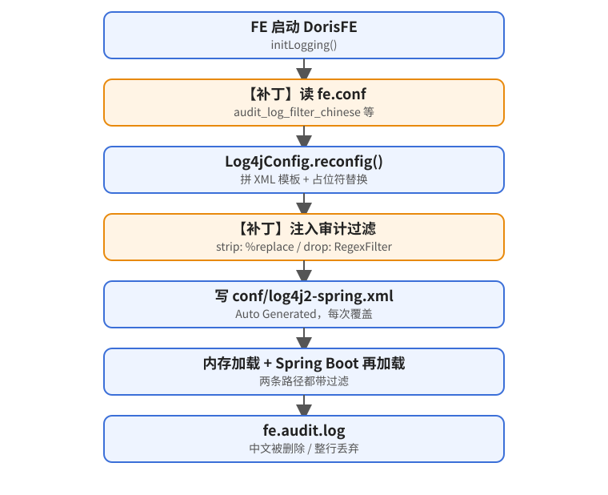

> 📊 **圖解版**：[設定生成流程、補丁驗證順序與三種模式](/visual/doris-audit-log-strip-chinese-with-ai.html)（單頁 HTML，由 answer-me-with-html 產生）

> [!VIEWPOINT] 核心觀點
> Doris 審計日誌的 log4j2 設定是 FE 啟動時由 `Log4jConfig` 產生的，要抗重啟就得改這個產生器本身。整個補丁只替換 `doris-fe.jar` 裡的一個 class，用官方二進位包做 classpath 單獨編譯，不必全量編譯 Doris。

> 本文所有數字都來自這次的真實操作記錄。伺服器地址、主機名、叢集 ID、真實安裝路徑都已脫敏，命令裡統一用 `${DORIS_HOME}`、`./work`、`./src`、`$JAVA_HOME` 這類佔位符。

## 一、背景與需求

手上有兩套私有化部署的 Apache Doris，都是單 FE（Master）：

| 叢集 | FE 版本（`SHOW FRONTENDS` 的 Version） |
|---|---|
| A | `doris-2.1.6-rc04-653e315ba5` |
| B | `doris-2.1.2-rc04-b130df2488` |

需求很簡單：**FE 的審計日誌 `fe.audit.log` 裡不要出現中文**。SQL 裡的中文字串常量、中文別名、中文註釋都算。

麻煩在於，`${DORIS_HOME}/fe/conf/` 裡那個 `log4j2-spring.xml` 頭部寫著：

```xml
<!-- Auto Generated. DO NOT MODIFY IT! -->
<Configuration status="info" packages="org.apache.doris.common">
```

FE **每次啟動都會重新生成並覆蓋它**，手改審計 appender 的 pattern 撐不過一次重啟。把檔案設成只讀也不行：FE 寫不進去，直接啟動失敗。

## 二、和 AI 協作的過程

這次的分工大致是這樣的：

| 人提供 | AI 負責 |
|---|---|
| 準確版本號（`SHOW FRONTENDS\G` 的 `Version` 欄位） | 按 tag 拉對應原始碼，定位生成 XML 的程式碼（`Log4jConfig`） |
| 線上自動生成的 `log4j2-spring.xml` 內容（appender 名、pattern） | 先判斷有沒有**不換 jar** 就能做到的辦法（配置項、自訂模板） |
| 線上 `doris-fe.jar` 的 sha256 | 改程式碼、單類編譯、證明「未改動原始碼編譯結果 = 官方 class」 |
| 最終決定和上線操作 | 起測試 FE，跑四種模式 + 重啟 + 執行時改日誌級別，生成 README / diff / 校驗和 |

**一個真實的教訓：版本號拿錯過。**一開始對話裡給的版本是 2.1.2，AI 就照著 2.1.2 改了。後來使用者貼出線上生成的 XML，裡面有 `AuditFile`、`AuditConsole` 和 `<!--REPLACED BY AUDIT LOG MARKER-->`。AI 一核對原始碼發現：**2.1.2 根本沒有這些結構**（它只有一個叫 `Auditfile` 的審計 appender，小寫 f），這個 marker 要到 2.1.4 之後才出現。再跑一次 `SHOW FRONTENDS`，確認線上其實是 2.1.6-rc04，於是 2.1.2 的產物全部作廢重做。

所以第一步永遠是：

```sql
SHOW FRONTENDS\G   -- 只看 Version 字段，例如 doris-2.1.6-rc04-653e315ba5
```

版本號最後那段是 commit 短 hash。拿它和官方二進位制包裡 `Version` 類記錄的 `doris_build_short_hash` 對一下，就能確認原始碼 tag 選對了。

後來 B 叢集（真的是 2.1.2-rc04）也要同樣的補丁。這次 AI 沒有直接套用 2.1.6 的檔案，而是按 2.1.2 的原始碼結構重新移植了一遍（差異見第四節末尾）。

## 三、原理：為什麼改生成程式碼就能抗重啟



讀 [2.1.6-rc04 的 Log4jConfig.java](https://github.com/apache/doris/blob/2.1.6-rc04/fe/fe-core/src/main/java/org/apache/doris/common/Log4jConfig.java) 可以看到，FE 啟動時 `initLogging()` → `reconfig()` 會做這幾件事：

1. 用程式碼拼出一個 XML 模板，裡面帶各種 `<!--REPLACED BY ...-->` 佔位符；
2. 替換佔位符，再用 `StrSubstitutor` 把 `${sys_log_dir}` 這類變數填進去；
3. `SpringLog4j2Config.writeSpringLogConf()` 把結果寫到 `conf/log4j2-spring.xml`；
4. 直接在記憶體裡 `context.start(config)` 載入這份配置；
5. 之後 [HttpServer](https://github.com/apache/doris/blob/2.1.6-rc04/fe/fe-core/src/main/java/org/apache/doris/httpv2/HttpServer.java) 啟動 Spring Boot 時，通過 `logging.config` 指向這份檔案，再載入一次。

另外，通過 HTTP `POST /rest/v1/log` 在執行時改日誌級別，會呼叫 `Log4jConfig.updateLogging()` → `reconfig()`，把整套流程再走一遍。

結論很直接：**過濾規則只要寫進這個生成器，無論是重啟、Spring 重新載入，還是執行時 reconfig，生成出來的配置都會帶上它。**

Log4j2 有兩種現成手段可以用：

- **strip（刪除中文）**：用 PatternLayout 的 [`%replace{pattern}{regex}{substitution}`](https://logging.apache.org/log4j/2.x/manual/pattern-layout.html) 對 `%m` 做正則替換；
- **drop（整行丟棄）**：用 [`RegexFilter`](https://logging.apache.org/log4j/2.x/manual/filters.html)，訊息匹配就 `DENY`。

### 關鍵 diff（2.1.6-rc04，精簡）

```diff
     private static final String AUDIT_LOG_PATTERN
-            = AUDIT_LOG_MARKER_PLACEHOLDER + "%d{yyyy-MM-dd HH:mm:ss,SSS} [%c{1}] %m%n";
+            = AUDIT_LOG_MARKER_PLACEHOLDER + "%d{yyyy-MM-dd HH:mm:ss,SSS} [%c{1}] "
+            + AUDIT_LOG_MESSAGE_PLACEHOLDER + "%n";
 ...
             .append("    <Console name=\"" + AUDIT_LOG_CONSOLE_APPENDER + "\" target=\"SYSTEM_OUT\">\n")
+            .append("      " + AUDIT_LOG_FILTER_PLACEHOLDER + "\n")
 ...
             .append("    <RollingFile name=\"" + AUDIT_LOG_FILE_APPENDER + "\" fileName=\"${audit_log_dir}/fe.audit.log\" ...>\n")
+            .append("      " + AUDIT_LOG_FILTER_PLACEHOLDER + "\n")
 ...
+    static String auditMessagePattern() {
+        if (auditFilterMode.equals("strip")) {
+            return xmlEscape("%replace{%m}{" + auditChineseRegex + "}{" + auditChineseReplacement + "}");
+        }
+        return "%m";
+    }
+
+    static String auditFilterElement() {
+        if (auditFilterMode.equals("drop")) {
+            return "<RegexFilter regex=\"" + xmlEscape("(?s).*(?:" + auditChineseRegex + ").*")
+                    + "\" useRawMsg=\"false\" onMatch=\"DENY\" onMismatch=\"NEUTRAL\"/>";
+        }
+        return "";
+    }
 ...
         newXmlConfTemplate = strSub.replace(newXmlConfTemplate);
+        // 在 ${} 替换之后、用 String.replace（不是 replaceAll）注入，正则里的反斜杠原样保留
+        newXmlConfTemplate = newXmlConfTemplate.replace(AUDIT_LOG_MESSAGE_PLACEHOLDER, auditMessagePattern());
+        newXmlConfTemplate = newXmlConfTemplate.replace(AUDIT_LOG_FILTER_PLACEHOLDER, auditFilterElement());
 ...
         customConfDir = Config.custom_config_dir;
+        loadAuditFilterConf(confDir, customConfDir);
         reconfig();
```

有幾個細節：

- **配置項由補丁自己從 `fe.conf` / `fe_custom.conf` 讀取**，不用改 `Config.java`，所以只需要替換一個 class。Doris 的 `ConfigBase` 會忽略不認識的配置項，回滾到原版 jar 時這些配置項留在 fe.conf 裡也沒影響。
- **注入時機放在 `${}` 替換之後**，並且用 `String.replace` 而不是 `replaceAll`。否則 `\p{IsHan}` 裡的反斜槓會被當成替換串的轉義符吃掉。
- **注入的內容會先做 XML 轉義**（`& < > "`），不會因為正則裡的特殊字元把 XML 寫壞。
- **配置值非法時 FE 直接拒絕啟動**，例如 `audit_log_filter_chinese = foo` 會在 fe.out 裡報 `audit_log_filter_chinese config error: foo, must be none/strip/drop`。審計配置錯了就該儘早暴露，而不是悄悄失效。

### 生成後的 pattern 對比（AuditFile）

```xml
<!-- 原版 / none -->
<Pattern><!--REPLACED BY AUDIT LOG MARKER-->%d{yyyy-MM-dd HH:mm:ss,SSS} [%c{1}] %m%n</Pattern>

<!-- strip（默认） -->
<Pattern><!--REPLACED BY AUDIT LOG MARKER-->%d{yyyy-MM-dd HH:mm:ss,SSS} [%c{1}] %replace{%m}{[\p{IsHan}\p{InCJKSymbolsAndPunctuation}\p{InHalfwidthAndFullwidthForms}\p{InCJKCompatibilityForms}\p{InBopomofo}]+}{}%n</Pattern>

<!-- drop：appender 内多一行 -->
<RegexFilter regex="(?s).*(?:[\p{IsHan}\p{InCJKSymbolsAndPunctuation}\p{InHalfwidthAndFullwidthForms}\p{InCJKCompatibilityForms}\p{InBopomofo}]+).*" useRawMsg="false" onMatch="DENY" onMismatch="NEUTRAL"/>
```

除此之外，生成檔案的結構完全不變：logger、路徑、滾動策略、marker 都一樣。在 none / strip 模式下，原來放 filter 的位置會多出一行空白。

### 2.1.2-rc04 的差異

[2.1.2-rc04 的 Log4jConfig.java](https://github.com/apache/doris/blob/2.1.2-rc04/fe/fe-core/src/main/java/org/apache/doris/common/Log4jConfig.java) 結構更老，移植時做了這些調整：

- 模板是一整段字串常量 `xmlConfTemplate`，不是 `StringBuilder`，所以直接在模板裡加佔位符；
- 只有一個審計 appender `Auditfile`，沒有 `AuditConsole`，也沒有 AUDIT LOG MARKER；
- 沒有 `LogUtils`，啟動資訊改用 `System.out.println` 列印（fe.out 裡沒有 `StdoutLogger` 字首）；
- 三個配置項、預設值、校驗規則、注入方式和 2.1.6 版完全一致。

## 四、不全量編譯：只編譯一個類

全量編譯 Doris FE 要拉一大堆依賴，耗時長，還可能因為構建環境不同，編出和官方不一樣的位元組碼。這裡只改了一個類，所以完全可以：

1. 拿**同版本官方二進位制包**裡的 `fe/lib/*` 做 classpath；
2. 用 JDK 8 只編譯 `Log4jConfig.java`；
3. **先編譯未改動的原始碼，證明結果和官方 jar 裡的 class 逐位元組一致**，再編譯改過的版本；
4. 用 `jar uf` 只替換這一個條目。

官方 jar 是 JDK 8 編譯的：`Version` 類裡記錄的編譯器分別是 1.8.0_352（2.1.6）和 1.8.0_312（2.1.2）；class 檔案 major version 為 52（Java 8，見 [JVM 規範第 4 章](https://docs.oracle.com/javase/specs/jvms/se8/html/jvms-4.html)）。補丁 class 也必須是 52，這樣在 JDK 8/11/17 上都能載入。

可複用的命令（以 2.1.6-rc04 為例）：

```bash
# 0) 源码：只需要这一个文件
git clone --filter=blob:none --no-checkout https://github.com/apache/doris.git ./src
cd ./src && git fetch --depth 1 origin tag 2.1.6-rc04
mkdir -p ../work/orig/org/apache/doris/common
git show 2.1.6-rc04:fe/fe-core/src/main/java/org/apache/doris/common/Log4jConfig.java \
  > ../work/orig/org/apache/doris/common/Log4jConfig.java
cd ..

# 1) 官方二进制包解压后的 fe/lib 作为 classpath（这里记为 ./work/apache-doris-2.1.6-bin-x64）
LIB=./work/apache-doris-2.1.6-bin-x64/fe/lib
export PATH=$JAVA_HOME/bin:$PATH     # JDK 8

# 2) 自证：未改动源码 → 与官方 class 逐字节一致（注意 -g，否则调试信息不同）
javac -g -source 8 -target 8 -nowarn -cp "$LIB/*" -d ./work/cls/orig \
  ./work/orig/org/apache/doris/common/Log4jConfig.java
mkdir -p ./work/official && (cd ./work/official && unzip -qo "../../$LIB/doris-fe.jar" 'org/apache/doris/common/Log4jConfig*')
for f in ./work/official/org/apache/doris/common/Log4jConfig*.class; do
  cmp "$f" "./work/cls/orig/org/apache/doris/common/$(basename "$f")" && echo "same $(basename "$f")"
done
javap -v ./work/cls/orig/org/apache/doris/common/Log4jConfig.class | grep major   # major version: 52

# 3) 编译改过的源码（./work/new/... 是打过 patch 的 Log4jConfig.java）
javac -g -source 8 -target 8 -nowarn -cp "$LIB/*" -d ./work/cls/new \
  ./work/new/org/apache/doris/common/Log4jConfig.java

# 4) 复制一份官方 jar，只更新 Log4jConfig.class
cp "$LIB/doris-fe.jar" ./work/doris-fe.jar
(cd ./work/cls/new && jar uf ../../doris-fe.jar org/apache/doris/common/Log4jConfig.class)
```

兩個踩過的小坑：

- 編譯時**不加 `-g`**，內部類 `Log4jConfig$Tuple.class` 會和官方不一致；加上 `-g` 後兩個 class 都逐位元組一致。
- 2.1.2 版改動後新增了 import，導致行號變化，重新編譯出來的 `Tuple.class` 只差行號表。所以 `jar uf` **只更新 `Log4jConfig.class`**，內部類繼續用官方原檔案。

## 五、配置項與測試結果

| 配置項（寫在 `${DORIS_HOME}/fe/conf/fe.conf`） | 取值 | 預設 | 說明 |
|---|---|---|---|
| `audit_log_filter_chinese` | none / strip / drop | **strip** | none=原樣；strip=刪除中文；drop=含中文的審計記錄整行不寫 |
| `audit_log_chinese_replacement` | 字串 | 空 | strip 時用來替換中文的串，例如 `?`；不能包含 `{ } % $ \` |
| `audit_log_chinese_regex` | Java 正則 | `[\p{IsHan}\p{InCJKSymbolsAndPunctuation}\p{InHalfwidthAndFullwidthForms}\p{InCJKCompatibilityForms}\p{InBopomofo}]+` | 預設覆蓋漢字、中文標點、全形字元和注音；不能包含 `$`、`%`，花括號必須成對 |

讀取順序是 fe.conf → fe_custom.conf（後者覆蓋前者），也可以用 JVM `-D` 參數覆蓋。**注意：換上補丁 jar 後，即使什麼都不配，預設也是 strip。**

測試 SQL：

```sql
select '你好，世界！abc' as `中文别名` /* 注释：测试 */;
```

兩個版本分別用「官方二進位制包 + 補丁 jar」起單 FE（JDK 1.8.0_504）測試，fe.audit.log 裡 `Stmt=` 的實測結果一致：

| 模式 | fe.audit.log 中的 Stmt |
|---|---|
| none | <code>select &#39;你好，世界！abc&#39; as &#96;中文別名&#96; /&#42; 註釋：測試 &#42;/</code> |
| strip（預設，不寫任何配置） | <code>select &#39;abc&#39; as &#96;&#96; /&#42;&nbsp;&nbsp;&#42;/</code> |
| strip + replacement=`?` | <code>select &#39;?abc&#39; as &#96;?&#96; /&#42; ? &#42;/</code> |
| drop | 這條不寫入；同批的英文 SQL（`select 'hello world' as en_only`）正常寫入 |

另外還驗證了這些情況（兩個版本都測過）：

- 每次重啟後 `conf/log4j2-spring.xml` 的 mtime 都會變，內容帶 `%replace` 或 `RegexFilter`；
- `POST /rest/v1/log?add_verbose=org.apache.doris.qe` 在執行時觸發 reconfig 後，過濾仍然生效；
- 跨兩行的 SQL 也能正確處理（Doris 寫審計日誌前會把換行替換成空格）；
- 2.1.2 版在 `sys_log_mode = ASYNC` 下同樣生效；
- 配置非法值時 FE 拒絕啟動。

上線後的驗證命令：

```bash
grep "audit log chinese filter" ${DORIS_HOME}/fe/log/fe.out | tail -1
ls -l ${DORIS_HOME}/fe/conf/log4j2-spring.xml          # mtime 应该是本次启动时间
grep -n 'replace{%m}\|RegexFilter' ${DORIS_HOME}/fe/conf/log4j2-spring.xml
tail -n 3 ${DORIS_HOME}/fe/log/fe.audit.log           # 以 fe.conf 里实际的审计日志目录为准
```

## 六、交付前的防錯

**1）線上 jar 必須是官方原版。**如果線上的 `doris-fe.jar` 被別人改過，拿官方 jar 打補丁再替換上去，就會把那些改動悄悄抹掉。所以先比對 sha256：

| 版本 | 官方 `fe/lib/doris-fe.jar` sha256 |
|---|---|
| 2.1.6-rc04 | `6005bb99e7b13200ff192252d2a07d32a82fd3bf3a23c4cfe1078a33f7e7c937` |
| 2.1.2-rc04 | `608177785eaab4bc3aea3cf9757341aead84d2c29129531acbbf2e489b3a8337` |

這次 2.1.6 叢集線上 jar 的 sha256 和官方一致。

**2）補丁 jar 要逐個條目比對，確認只差一個 class。**`jar uf` 會重新壓縮，jar 的檔案大小會變，所以不能看大小，要比對每個條目的 CRC：

```python
import zipfile
a = zipfile.ZipFile('official/doris-fe.jar')
b = zipfile.ZipFile('patched/doris-fe.jar')
da = {i.filename: i.CRC for i in a.infolist()}
db = {i.filename: i.CRC for i in b.infolist()}
print(len(da), len(db), set(da) ^ set(db), [k for k in da if k in db and da[k] != db[k]])
```

實測結果：

- 2.1.6：`7354 7354 set() ['org/apache/doris/common/Log4jConfig.class']`
- 2.1.2：`6955 6955 set() ['org/apache/doris/common/Log4jConfig.class']`

**3）替換和回滾（由人來操作，每個 FE 都要做）：**

```bash
cd ${DORIS_HOME}/fe
sha256sum lib/doris-fe.jar                 # 必须等于上表中对应版本的官方值
./bin/stop_fe.sh
cp -p lib/doris-fe.jar ./backup/doris-fe.jar.orig   # 备份到 lib 目录以外
cp ./patch/doris-fe.jar lib/doris-fe.jar
echo "audit_log_filter_chinese = strip" >> conf/fe.conf   # 可选，默认就是 strip
./bin/start_fe.sh --daemon

# 回滚
./bin/stop_fe.sh && cp -p ./backup/doris-fe.jar.orig lib/doris-fe.jar && ./bin/start_fe.sh --daemon
```

## 七、免換 jar 的方案：`-Dlogging.config` 及其侷限

使用者最初問的是：有沒有不換 jar 的辦法？Doris 沒有現成的配置項能控制審計 pattern。不過讀 HttpServer 原始碼可以發現，`logging.config` 是作為 Spring 的**預設屬性**（優先順序最低）傳進去的。因此可以在 fe.conf 的 `JAVA_OPTS`（JDK 17 對應 `JAVA_OPTS_FOR_JDK_17`）最前面加上：

```bash
-Dlogging.config=${DORIS_HOME}/fe/custom/log4j2-audit-strip.xml
```

讓 Spring Boot 載入一份放在 conf 目錄之外、不會被覆蓋的靜態 log4j2 配置。在 2.1.6 上用**官方原版 jar** 實測，審計日誌裡的中文確實被刪掉了，但侷限也很明顯：

1. **執行時一改日誌級別就失效。**通過 `/rest/v1/log` 修改日誌級別會觸發 `reconfig()`，切回程式碼生成的配置，審計日誌馬上又出現中文，直到下次重啟。這一點已實測復現。
2. 靜態 XML 不再跟隨 fe.conf 裡 `sys_log_*` / `audit_log_*` 的變化，需要手工維護。
3. 從 FE 啟動到 HTTP 服務起來之前，用的仍是原配置。這段時間還沒有查詢，所以基本不影響審計日誌。

這個方案在 2.1.2 上只讀了原始碼（機制相同），沒有實測。考慮到第 1 條，最終選擇了換 jar。

## 八、風險與邊界

- **`__internal_schema.audit_log` 表不受影響。**內建審計外掛 AuditLoader 寫表走的是另一條路徑，不經過這個 appender，表裡仍是原始 SQL（含中文）（見官方文件 [審計日誌](https://doris.apache.org/zh-CN/docs/3.x/admin-manual/audit-plugin/)）。如果表裡也要去中文，需要另外處理。fe.log、fe.warn.log 同樣不受影響（見 [FE 日誌管理](https://doris.apache.org/zh-CN/docs/3.x/admin-manual/log-management/fe-log/)）。
- **drop 模式有合規風險**：含中文的查詢會從 fe.audit.log 裡完全消失。一般建議用 strip。
- **strip 會改變 SQL 文本**：日誌裡的 SQL 可能沒法直接複製執行。SqlHash 仍按原始 SQL 計算。
- **jar 和版本強繫結**：2.1.6 和 2.1.2 的 jar 不能混用；升級 Doris 後必須基於新版本原始碼重新打補丁。
- 測試只覆蓋了 JDK 8 執行時和單 FE。多 FE 時每個 FE 都要替換。

## 九、小結：用 AI 做私有化補丁的幾條經驗

1. **給足上下文，尤其是準確版本號。**`SHOW FRONTENDS` 的 Version、線上生成的配置檔案、線上 jar 的 sha256，比任何口頭描述都可靠。這次走過的唯一一段彎路，就是版本號拿錯了。
2. **讓 AI 自證一致性。**不要只要一個「編譯好的 jar」，而是要它證明：未改動原始碼編譯出的 class 與官方逐位元組一致，補丁 jar 與官方 jar 只差目標 class。這兩條證據成立，替換的風險就很可控。
3. **最小改動。**只改生成器一個類；配置項由補丁自己讀取，不碰 `Config.java`；生成檔案的結構保持不變；配置非法時 FE 拒絕啟動，不讓過濾悄悄失效。
4. **先找免改程式碼的方案，並把侷限講清楚。**`-Dlogging.config` 能用，但一次執行時 reconfig 就會失效。這類邊界一定要實測，不能只靠推斷。
5. **人來做最後一步。**停 FE、備份、替換、回滾這些生產操作，由人按 README 執行；AI 負責準備好材料，並給出可核對的證據。

## 參考

- apache/doris `Log4jConfig.java`：[2.1.6-rc04](https://github.com/apache/doris/blob/2.1.6-rc04/fe/fe-core/src/main/java/org/apache/doris/common/Log4jConfig.java) ｜ [2.1.2-rc04](https://github.com/apache/doris/blob/2.1.2-rc04/fe/fe-core/src/main/java/org/apache/doris/common/Log4jConfig.java)
- apache/doris `HttpServer.java`（`logging.config`）：[2.1.6-rc04](https://github.com/apache/doris/blob/2.1.6-rc04/fe/fe-core/src/main/java/org/apache/doris/httpv2/HttpServer.java)
- Apache Doris 文件：[審計日誌](https://doris.apache.org/zh-CN/docs/3.x/admin-manual/audit-plugin/) ｜ [FE 日誌管理](https://doris.apache.org/zh-CN/docs/3.x/admin-manual/log-management/fe-log/)（2.1 文件已歸檔，連結為當前版本）｜ [下載](https://doris.apache.org/download)
- Log4j2：[Pattern Layout（%replace）](https://logging.apache.org/log4j/2.x/manual/pattern-layout.html) ｜ [Filters（RegexFilter）](https://logging.apache.org/log4j/2.x/manual/filters.html)
- [JVM 規範第 4 章：class 檔案格式（major version）](https://docs.oracle.com/javase/specs/jvms/se8/html/jvms-4.html)
