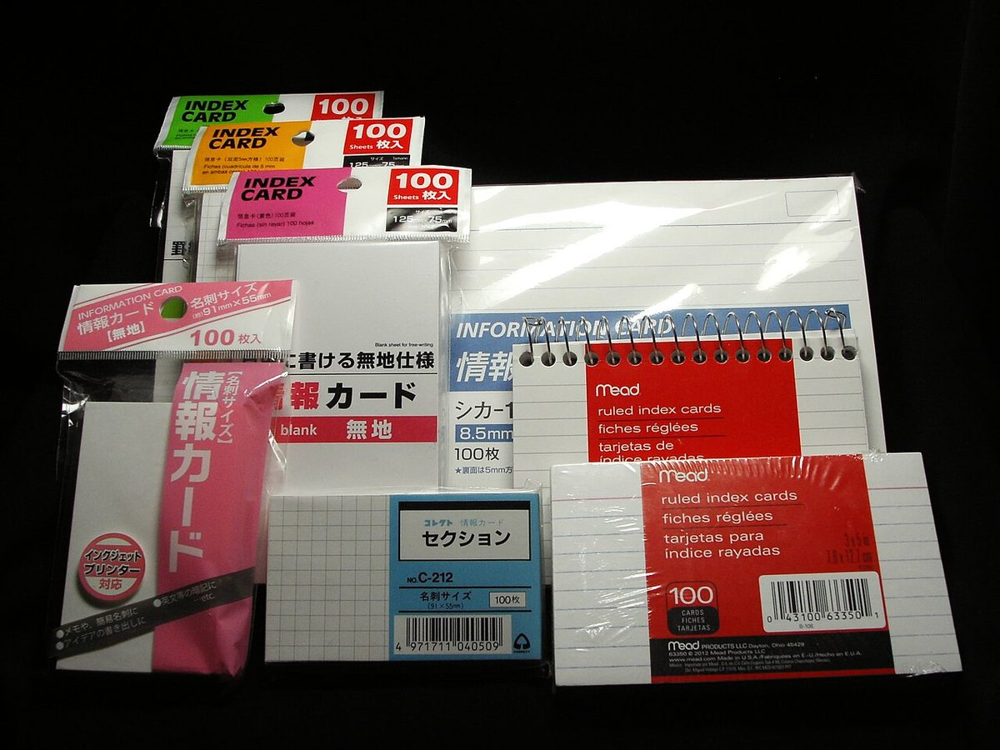

> 素材說明：本文不是某一本書的讀書筆記，而是一套**可複用的筆記方案**。方法來源以我實際開啟並閱讀的公開網頁為準：臺灣《閱讀前哨站》（readingoutpost.com，創辦人瓦基）關於讀書心得、卡片盒筆記與筆記方法比較的文章；Tiago Forte 在 Forte Labs 上的 Progressive Summarization 原文；以及 Wikimedia Commons 等開源圖片的許可證頁。引號內句子均可在文末「參考資料」核對。我沒有購買瓦基的付費課程《化輸入為輸出》《卡片盒筆記實戰課》，課程大綱與 HQ&A 步驟只引用其公開頁面上的說明。

<figure>

<figcaption>圖片：Heffloaf / <a href="https://commons.wikimedia.org/wiki/File:Stack_of_Books.jpg">Wikimedia Commons</a>，<a href="https://creativecommons.org/licenses/by-sa/4.0/">CC BY-SA 4.0</a>。已壓縮並本地託管。</figcaption>
</figure>

## 一、為什麼工程師需要「方案」，而不是「多記幾頁」

工程師讀書有兩個常見失敗模式：

1. **劃線很多，輸出很少。** Kindle / 瀏覽器高亮堆成山，三個月後搜不到，也講不清楚。
2. **寫得很滿，用不上。** 筆記像全書縮寫，卻找不到和 on-call、code review、排期激勵相關的那一句話。

臺灣書評博主瓦基在《閱讀前哨站》裡反覆強調的，恰好對準這兩點。在〈讀書心得怎麼寫？〉裡，他把筆記方法收成三個訣竅：**簡單好上手**；**不要仰賴靈感，而是對既有資訊做出討論**；以及 **「筆記 = 複習 + 學習 + 寫作」**。同文還給出思維翻轉：「先紀錄、後思考」「用自己的話重新闡述」「發展和自己有關的想法」——而不是「先想清楚再動筆」「反覆抄寫」「只忠實記錄知識原貌」。

對工程師來說，第三點尤其重要：**筆記的終點不是收藏，而是能寫進設計文件、復盤、1:1 和部落格的可檢驗主張。**

另一條線索來自卡片盒筆記。瓦基在〈正確使用卡片盒筆記法的六個關鍵步驟〉裡整理了靈感筆記 → 文獻筆記 → 永久筆記 → 索引 → 關鍵詞索引 → 寫作的流程，並引用 Luhmann 的意思：一則筆記的品質，來自它在系統裡的網路連結。工程師已有類似習慣——issue、ADR、RFC、wiki 雙鏈——缺的是把**讀書輸入**接到同一套網路上。

本文把閱讀前哨站的「輸入→處理→輸出」、卡片盒的原子化連結，以及 Tiago Forte 的漸進式總結，收成一套**工程師讀書筆記方案**，並落到本站 Hugo 倉庫裡的 archetype 與配圖規範。

## 二、方法論來源（核實過的要點）

### 1. 閱讀前哨站：單一來源如何變成一篇心得

站點身份先說清楚：**《閱讀前哨站》是瓦基（曾在臺積電任職）經營的繁體中文書評與方法部落格**，官網為 [readingoutpost.com](https://readingoutpost.com/)，不是 bmpi.dev。

公開文章裡，和「寫讀書筆記」直接相關的幾條：

| 方法 | 出處 | 工程師可怎麼用 |
|---|---|---|
| **節錄評論法** | [how-to-take-note](https://readingoutpost.com/how-to-take-note/) | 記下頁碼 + 原文要點，下面寫自己的評論；回看時刪掉「不再重要」的標籤 |
| **一問一答法** | 同上 | 為什麼讀？一句話核心？推薦給誰？（技術語境可改成：解決什麼工程問題？一句話原則？適合哪個角色？） |
| **萬能寫作框架** | 同上 | 觀點 → 案例 → 總結；寫作是「由下而上」編排已有筆記，不是對著空白頁硬寫 |
| **HQ&A** | [learn-in-out 課程大綱](https://readingoutpost.com/learn-in-out/)、[zettelkasten-practice](https://readingoutpost.com/zettelkasten-practice/) | Highlight → Question → Answer：對重點自問自答，用自己的話寫答案 |
| **化輸入為輸出** | [zettelkasten-vs-inoutcourse](https://readingoutpost.com/zettelkasten-vs-inoutcourse/) | 針對**單一來源**寫出一篇紮實心得；三種筆記法 + 輸出框架 |
| **卡片盒四特性** | [zettelkasten-difference](https://readingoutpost.com/zettelkasten-difference/) | 連結性、原子化、可擴充、再訪性；區分「筆記格式」與「筆記系統」 |

瓦基在比較課程時寫得很清楚：任何知識管理都含輸入、處理、輸出；《化輸入為輸出》偏「單一來源 → 一篇文章」，《卡片盒筆記實戰課》偏「多來源 → 長期知識體系」。工程師寫部落格式讀書筆記，前者夠用；要跨書形成自己的架構觀，需要後者。

<figure>

<figcaption>圖片：Goatid / <a href="https://commons.wikimedia.org/wiki/File:Index_cards.jpg">Wikimedia Commons</a>，<a href="https://creativecommons.org/licenses/by-sa/3.0/">CC BY-SA 3.0</a>。卡片盒筆記的實體隱喻。</figcaption>
</figure>

### 2. 卡片盒六步（公開整理版）

據瓦基整理的六步（原文有更細的 Luhmann 文獻筆記格式討論）：

1. **靈感筆記（Fleeting）**：快速捕捉，媒介不重要。
2. **文獻筆記（Literature）**：選擇性、簡短、**用自己的話**，註明書名作者年份頁碼。
3. **永久筆記（Permanent）**：一則一個完整想法，寫給「別人」能看懂；並問：反駁/支援了什麼舊知？如何組合？觸發什麼新問題？
4. **索引卡片**：編號與位置本身參與記憶（實體場景）；數字工具則用雙鏈/白板空間。
5. **關鍵詞索引**：手動維護主題入口，避免只靠全文搜尋。
6. **好玩（Playful）**：能持續的系統，必須不太痛苦。

永久筆記與文獻筆記的對照（瓦基轉述 Eva Keiffenheim）：文獻是「作者的問題與事實」；永久是「與你工作/好奇的關聯」——工程師可以把「工作」具體成：線上事故、評審爭議、招聘標準、技術債策略。

### 3. 漸進式總結：把壓縮攤到時間裡

Tiago Forte 在 Forte Labs 的 [Progressive Summarization](https://fortelabs.com/blog/progressive-summarization-a-practical-technique-for-designing-discoverable-notes/) 裡提出：難的不是獲取資訊，而是把知識**轉發到未來真正用得上的時刻**；單則筆記要在「可發現性（壓縮）」與「可理解性（上下文）」之間平衡。分層大致是：

- Layer 0：原文  
- Layer 1：摘入筆記的片段  
- Layer 2：加粗精華  
- Layer 3：高亮「精華中的精華」  
- Layer 4：用**自己的話**寫執行摘要  
- 極少數：改寫成部落格、幻燈、程式碼實驗  

關鍵約束：**只在本來就要複習這條筆記時加下一層**（機會性壓縮），不要對所有高亮走完全流程。這和工程師的「不是每個 ticket 都值得寫 ADR」是同一類判斷。

<figure>

<figcaption>圖片：Grendelkhan / <a href="https://commons.wikimedia.org/wiki/File:Pile_of_light_gray_LEGO_bricks_at_a_LEGO_store.jpg">Wikimedia Commons</a>，<a href="https://creativecommons.org/licenses/by-sa/4.0/">CC BY-SA 4.0</a>。原子化筆記 ≈ 可重組的積木。</figcaption>
</figure>

## 三、工程師版流程：八步閉環

把上面來源收成一條可執行流水線（對應本站 archetype `archetypes/reading-notes.md`）：

```
選書 → 帶著問題讀 → 摘錄(L1) → 轉述/HQ&A(L2-L4)
     → 連到工程場景 → 寫侷限 → 檢查清單 → 釋出與復盤
```

### 1. 選書（工程師標準，不是暢銷榜）

優先滿足至少一條：

- 能解釋你最近一次**真實失敗**（事故、延期、激勵反噬、架構返工）  
- 能和已有筆記/部落格形成**對照或反駁**（例如《驅動力》對《混合訊號》）  
- 有可核對的**一手材料**（論文、監管檔案、作者專欄），避免只能轉述營銷文案  

不選：只有金句、無可檢驗主張、或你明確不會在工作中用到的雞湯。

### 2. 帶著輸出前提讀

瓦基建議：吸收時想著「之後要寫出可公開發表的筆記」。工程師可改成更硬的提問：

- 這本書想推翻我哪條預設假設？  
- 三個月後，我希望哪一條能寫進團隊手冊？  

### 3. 摘錄（文獻筆記 / Layer 1）

- 只留對你有意義的段落；頁碼或章節號必填  
- **禁止**大段無評論貼上  
- 繁體原文引用時保留繁體字形，並註明出處  

### 4. 轉述（節錄評論 / HQ&A / Layer 4）

每條高價值摘錄至少做一件：

- 寫 2–5 句自己的評論；或  
- 寫成 HQ&A：問題用工程語言（「為什麼 on-call 獎金可能傷害協作？」）  

檢驗標準：**合上書，你還能向同事講清楚嗎？** 講不清就還沒轉述完。

### 5. 連線工程實踐（永久筆記的「與自己有關」）

強制對映到具體工件，例如：

| 書裡的概念 | 工程落點 |
|---|---|
| 激勵是訊號 | 績效等級、on-call 津貼、Hackathon 獎品的文案是否互相打架 |
| 精要 / 輕鬆 | 路線圖砍什麼；Runbook 如何變「預設輕鬆」 |
| 迂迴 / 本質思考 | 大改版是否該先畫因果環與槓桿點，再小步試 |
| 讓別人贏 | Code review 是補臺還是拆臺；跨團隊介面的「兩清」 |

沒有這一步，筆記停在「懂了作者」；有這一步，才進入「改自己的系統」。

### 6. 寫侷限與邊界

每篇公開筆記至少回答：

- 作者假設的組織規模/文化是什麼？  
- 哪些主張**缺少**你能核對的證據？  
- 什麼場景下照做會有害？（例如在強合規環境裡盲目「少即是多」）  

本站既有筆記裡「素材說明」置頂，就是在落實這一點。

### 7. 檢查清單（給未來的自己和讀者）

清單要可勾選、可在下週站會用，例如：

- [ ] 本週績效溝通裡，有沒有一條激勵和公開價值觀衝突？  
- [ ] 新需求是否先問「能不能刪除」再問「怎麼做」？  

### 8. 釋出與復盤

- 用 Hugo archetype 生成草稿；`date` 設為釋出時間前幾分鐘（Hugo 不渲染未來日期）  
- `reading_extent` 如實填寫：`full` / `partial` / `secondary-sources-only`  
- 一個月後回訪：哪條清單真的改了行為？把結果補進 `lastmod` 段落  

<figure>

<figcaption>圖片：Martin Grandjean / <a href="https://commons.wikimedia.org/wiki/File:Social_Network_Analysis_Visualization.png">Wikimedia Commons</a>，<a href="https://creativecommons.org/licenses/by-sa/3.0/">CC BY-SA 3.0</a>。筆記之間的連結品質，決定知識網路是否有用。</figcaption>
</figure>

## 四、公開部落格的品質標準（本站約定）

1. **每條引文可回溯。** 引號內容必須能在「參考資料」的 URL 或頁碼上核對；不「憑印象復原」書中原話。  
2. **標明閱讀程度。** 沒讀全文就寫在文首；只讀到目錄/書摘/專欄時，不偽裝成全書精讀。  
3. **簡體正文 + 繁體對照。** 臺灣/香港譯本的書名、關鍵譯名、書評儘量並列，避免只活在簡體市場的資訊繭房。  
4. **工程落點 + 侷限 + 清單** 三段不缺。  
5. **配圖合規。** 只用開源許可圖片，本地託管，文內署名（見下一節）。  
6. **簡單優先。** 工具可以是 Obsidian / Heptabase / 純 Markdown；流程複雜到不想用，就違反了瓦基的第一條訣竅。

## 五、Hugo 模板與目錄約定

本倉庫新增 archetype：`archetypes/reading-notes.md`。

建立範例：

```bash
~/.local/bin/hugo new content/posts/my-book-reading-notes.md --kind reading-notes
```

Front matter 關鍵欄位：

- `date` / `draft` / `tags` / `summary` / `ShowToc`  
- `books[]`：原書、簡繁體版本資訊  
- `reading_extent`：閱讀程度宣告  

建議章節骨架（與 archetype 正文一致）：書籍資訊 → 核心觀點（轉述）→ 工程實踐 → 侷限 → 清單 → 參考資料。

既有四篇讀書筆記（讓別人贏、精要×輕鬆、混合訊號×驅動力、間接思考×本質思考）已經按同一骨架寫；本文釋出後，它們補上開源配圖並更新 `lastmod`。

## 六、配圖規範（開源社群圖片）

原則：

1. **來源白名單**：Wikimedia Commons、Unsplash（Unsplash License）、CNCF/Kubernetes 官方 artwork、unDraw（按其網站許可）等。  
2. **先核許可證再下載**：Commons 用 API / 檔案頁確認 `CC0` / `CC BY` / `CC BY-SA` / 公有領域等。  
3. **本地託管**：放入 `static/images/<slug>/`，**禁止熱鏈**外站圖床。  
4. **壓縮**：單圖目標 &lt; 300KB；可縮小最長邊並降低 JPEG quality。  
5. **署名**：圖片下方寫清作者、來源連結、許可證連結；若做過裁剪/壓縮，可註明「已壓縮」。  
6. **相關性**：圖必須服務論點（卡片→原子化，交通燈→訊號，迷宮→迂迴），不為裝飾硬塞。

本頁四張圖均來自 Wikimedia Commons，許可證見各圖注。

## 七、侷限（這套方案自身的邊界）

- **公開部落格 ≠ 私密第二大腦。** 有些文獻筆記涉及未公開業務，只應留在私有庫；公開文只輸出已脫敏的永久筆記級結論。  
- **瓦基課程細節未親測。** HQ&A 與課程周次來自公開大綱與書評文，實施節奏以你自己的迭代為準。  
- **卡片盒有維護成本。** 若一週讀一本卻從不連結舊筆記，系統會退化成資料夾收藏；寧可少寫永久筆記，也要寫能鏈上的。  
- **漸進式總結不適合合規審計材料。** 需要完整上下文的法規、合同、事故時間線，應保留全文歸檔，而不是只留高亮層。

## 八、檢查清單（用這套方案寫下一篇時）

- [ ] 文首寫了閱讀程度與素材邊界  
- [ ] 至少使用一種閱讀前哨站方法（節錄評論 / 一問一答 / HQ&A）並留下痕跡  
- [ ] 每個核心觀點有工程落點，不只是書摘  
- [ ] 有「侷限」節，且至少指出一條反例或前提  
- [ ] 「參考資料」裡每個被引用主張都有可點開的連結或明確頁碼  
- [ ] 若配圖：許可證已核、檔案在 `static/images/<slug>/`、圖注含作者與許可  
- [ ] `hugo` 本地構建通過；`date` 不在未來  

## 參考資料

1. 瓦基，〈【教學】讀書心得怎麼寫？顛覆舊觀唸的三種筆記和寫作技巧〉，閱讀前哨站：<https://readingoutpost.com/how-to-take-note/>  
2. 瓦基，〈正確使用卡片盒筆記法（Zettelkasten）的六個關鍵步驟〉：<https://readingoutpost.com/zettelkasten-6-steps/>  
3. 瓦基，〈【如何挑選筆記方法？】卡片盒筆記和其他四種筆記法的差異〉：<https://readingoutpost.com/zettelkasten-difference/>  
4. 瓦基，〈讀書心得怎麼寫？五個步驟…〉（化輸入為輸出課程頁，含 HQ&A 周次大綱）：<https://readingoutpost.com/learn-in-out/>  
5. 瓦基，〈《知識複利筆記術》讀後心得…〉（文中歸納 HQ&A 三步）：<https://readingoutpost.com/zettelkasten-practice/>  
6. 瓦基，〈《化輸入為輸出》和《卡片盒筆記實戰課》有什麼差異？〉：<https://readingoutpost.com/zettelkasten-vs-inoutcourse/>  
7. 閱讀前哨站首頁（站點身份與作者背景）：<https://readingoutpost.com/>  
8. Tiago Forte，*Progressive Summarization: A Practical Technique for Designing Discoverable Notes*，Forte Labs：<https://fortelabs.com/blog/progressive-summarization-a-practical-technique-for-designing-discoverable-notes/>  
9. Wikimedia Commons 檔案頁（本頁配圖許可證來源）：[Stack of Books](https://commons.wikimedia.org/wiki/File:Stack_of_Books.jpg)、[Index cards](https://commons.wikimedia.org/wiki/File:Index_cards.jpg)、[LEGO bricks pile](https://commons.wikimedia.org/wiki/File:Pile_of_light_gray_LEGO_bricks_at_a_LEGO_store.jpg)、[Social Network Analysis Visualization](https://commons.wikimedia.org/wiki/File:Social_Network_Analysis_Visualization.png)  
