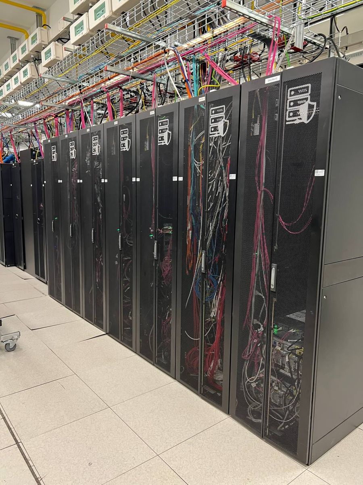

<figure>

<figcaption>图片：VPSExpertYuri / <a href="https://commons.wikimedia.org/wiki/File:Servers.jpg">Wikimedia Commons</a>，<a href="https://creativecommons.org/licenses/by-sa/4.0/">CC BY-SA 4.0</a>。从一张 Hash 表到一排机架，变的是尺度，不变的是原理。</figcaption>
</figure>

## 写在前面

李智慧这个名字，很多后端工程师最早是在一本书的封面上看到的：2013 年电子工业出版社出版的《大型网站技术架构：核心原理与案例分析》。后来他在极客时间陆续开了《从 0 开始学大数据》《后端技术面试 38 讲》和《李智慧 · 高并发架构实战课》。按极客时间上的介绍，他做过阿里巴巴技术专家、Intel 亚太研发中心架构师、宅米和 WiFi 万能钥匙 CTO，后来任同程旅行交通首席架构师，也给 Apache Spark 贡献过代码。

把这些书和专栏放在一起读，最强烈的感受是：**他讲的东西看起来跨度很大，从 Hash 表、JVM、设计模式，到负载均衡、HDFS、秒杀系统，再到德雷福斯模型，其实一直在用同一种方式拆问题。**

我想用一句话来概括这篇文章的主线：

> **技术世界里真正需要掌握的原理并不多，它们只是在不同尺度上一遍遍出现。架构师的本事，是在新问题里认出老原理。**

下面按"方法 → 软件设计 → 系统架构 → 大数据 → 人"的顺序展开，最后谈谈我认为这些观点在今天有哪些局限。

## 一、方法：第一性原理，把"学习"变成"验证"

《后端技术面试 38 讲》的开篇词就叫《掌握软件开发技术的第一性原理》。他的出发点是：新技术层出不穷，每次从头学都很痛苦，以至于行业里流传着"35岁以后就不能写代码了"的说法。而他认为"太阳底下没有新鲜事，绝大多数新技术其实都脱胎于一些既有的技术体系"。

他对理想状态的描述，我觉得是整个专栏最有价值的一段：建立了自己的技术思维体系之后，再碰到新技术，"这个时候你其实不需要去学习这个新技术了，而是去验证这个新技术"。也就是先根据原理推导它大概会怎么实现，再去看文档和代码，验证自己猜得对不对。

落到操作层面，他在《从 0 开始学大数据》的答疑里给过一个很具体的方法，叫 **5-20-2 法则**：

- 用 5 分钟了解新知识的特点、应用场景和要解决的问题；
- 用 20 分钟理解它的主要设计原理、核心思想和思路；
- 再花 2 个小时看关键设计细节，尝试使用或者写个 demo。

每一步过不去就先放下。顺序很重要：**先问它解决什么问题，最后才看细节。**多数人正好反过来，于是知识永远是孤立的点。

他在同一篇答疑里还有一句话，我把它当作这套方法的目标：要做工具的主人，而不是工具的奴隶，"最终的目标是要超越 Hadoop，打造适合自己业务场景的大数据解决方案"。

## 二、软件设计：好代码的唯一标准是"能扛住变化"

### 2.1 糟糕的设计会"腐坏"

在《软件设计的目的：糟糕的程序员比优秀的程序员差在哪里？》里，他给出了一个很锋利的判断：**好的设计和坏的设计最大的差别，体现在应对需求变更的能力上。**差的程序员害怕需求变更，好的程序员欢迎需求变更，因为他们一开始就是针对变更去设计的。

他列了糟糕设计的五个特征：**僵化性**（改一处牵动一大片）、**脆弱性**（改了这里，莫名其妙坏了那里）、**牢固性**（想复用一部分，却拆不出来）、**粘滞性**（坏的改法比好的改法更容易实施，于是软件越改越烂）、**晦涩性**（代码看不懂，后人只能乱改）。

他用的例子极其朴素：一个把键盘输入拷贝到打印机的 `copy()` 函数。第一次需求变更要支持纸带机输入，加了一个布尔变量 `ptFlag`；第二次要支持输出到纸带机，又加了 `ptFlag2`，还配了一行注释"使用前请重置这些flag"。两次变更以后，一段清晰的代码就同时具备了僵化、脆弱、粘滞、晦涩四种病。

解法是把输入和输出抽象成 `Reader` 和 `Writer` 接口，`copy` 只依赖接口。有意思的是，用 Go 写这个例子时，**标准库已经替你做好了这件事**：

```go
// copyChars 只依赖抽象：任何 io.Reader 到任何 io.Writer。
// 键盘、文件、网络连接、内存缓冲……都不需要改这一行代码。
func copyChars(r io.Reader, w io.Writer) error {
	br, bw := bufio.NewReader(r), bufio.NewWriter(w)
	defer bw.Flush()
	for {
		c, err := br.ReadByte()
		if err == io.EOF {
			return nil
		}
		if err != nil {
			return err
		}
		if err := bw.WriteByte(c); err != nil {
			return err
		}
	}
}
```

`io.Reader`/`io.Writer` 之所以成为 Go 生态里最成功的两个接口，原因和李智慧讲的完全一样：它们把"变化的东西"（设备）和"不变的东西"（拷贝逻辑）隔开了。

### 2.2 面向对象的本质是多态，框架的本质是依赖倒置

我认为《后端技术面试 38 讲》里写得最透的是第 12 篇和第 16 篇。

第 16 篇指出，C 语言用结构体和函数指针也能实现封装、继承和多态，只是没有语法和编译上的约束，很危险。所以他的结论是：**多态才是面向对象编程的本质，设计模式的精髓就是对多态的灵活应用。**

第 12 篇讲依赖倒置原则，最有价值的一点是他强调了一个很多人忽略的细节：**依赖倒置的关键不是"依赖接口"，而是"接口归谁所有"。**Service 层依赖 DAO 层定义的接口，这不叫依赖倒置；只有接口由高层（Service）定义、低层（DAO）去实现，才算倒置。他的 `Button`/`Lamp` 例子里，抽象接口叫 `ButtonServer`，归高层的 Button 所有，"我们从命名上也能看的出来，这正是依赖倒置原则的精髓所在"。

由此他回答了一个看似神奇的问题：为什么我们的程序不调用 Tomcat、Spring 的代码，却能用上它们的功能？因为框架遵循的是好莱坞原则，"Don't call me, I will call you"：应用实现框架定义的接口（比如 `Servlet`），由框架来调用应用。

第 17 篇顺势给出了框架和工具的区别：**框架调用你的代码，工具被你的代码调用。**Tomcat 是框架，Log4J 是工具。

这里我想补充一个他在第 7 篇里没有展开的观察。他在讲编程语言演化时，把 Go 的隐式接口当作"对象的边界和封装性开始模糊"的例子。但从依赖倒置的角度看，**Go 的隐式接口反而让"接口归高层所有"变得最自然**：调用方可以在自己的包里声明一个只含所需方法的小接口，被调用方完全不需要知道它的存在，也不用 import 它。Go 社区"在使用方定义接口"的惯例，本质上就是第 12 篇讲的接口所有权倒置。同一个原理，在不同的语言里有不同的落地方式。

## 三、系统架构：高并发是根源，三板斧是手段

### 3.1 大型网站是演化出来的

《大型网站技术架构》第一章画了一条演化路径：从单机网站开始，经过应用与数据分离、缓存、集群、读写分离、CDN、分布式存储、业务拆分，最终走到分布式服务。

比路径本身更重要的是这一章的"价值观"和"误区"两节。价值观有两条：**大型网站架构技术的核心价值是随网站所需灵活应对；驱动大型网站技术发展的主要力量是网站的业务发展。**误区有三条：**一味追随大公司的解决方案、为了技术而技术、企图用技术解决所有问题。**据读者整理的读书笔记，这本书的后记还有一句很有名的话：大型网站不是设计出来的，而是逐步演化出来的。

这和第二节讲的软件设计是同一个道理：**不要试图一次性预测所有变化，而是让系统在每一个阶段都保留应对下一次变化的能力。**

### 3.2 五个要素，以及它们之间的关系

书中第三章提出，除了功能需求，软件架构还要关注**性能、可用性、伸缩性、扩展性、安全性**五个要素，"架构设计过程中需要平衡这 5 个要素之间的关系"。几个定义很值得记住：

- **可用性**的前提是服务器必然会宕机，主要手段是冗余。
- **伸缩性**指通过往集群里加服务器来应对增长；缓存集群加机器可能导致路由失效，需要改进路由算法。
- **扩展性**直接关注功能需求，主要手段是事件驱动架构和分布式服务。

我的理解是：**伸缩性是对"量"的变化开放，扩展性是对"功能"的变化开放。**后者本质上就是开闭原则在系统层面的版本。

到了《高并发架构实战课》，他进一步厘清了"三高"的关系：**高并发、高性能、高可用并不是平行的，高并发是根源和核心。**大量用户同时请求导致资源快速消耗、响应变慢，这是性能问题；性能继续恶化导致资源耗尽、系统崩溃，这就是可用性问题。

### 3.3 水平伸缩与"三板斧"

应对高并发，他把方案分成两类：**垂直伸缩**（换更强的机器）和**水平伸缩**（用更多机器组成集群）。互联网走的是后一条路，因为它有天然的弹性，可以"一台服务器一台服务器地添加资源"，而互联网应用很难提前估计会有多少用户、在什么时候来访问。

在《高性能架构的三板斧》里，他先给出一个简单的关系：**吞吐量 = 并发数 ÷ 响应时间**。随着并发增加，系统依次经历性能测试区间（吞吐量上升、响应时间基本不变）、负载测试区间（吞吐量见顶后下降、响应时间上升）和压力测试区间（直到崩溃，吞吐量为 0）。

架构层面的三板斧是：

| 手段 | 解决什么压力 | 关键点 |
|---|---|---|
| 负载均衡 | 单台服务器的并发压力 | 应用层负载均衡会成为瓶颈；大规模集群多用链路层负载均衡，响应不再经过负载均衡服务器 |
| 分布式缓存 | 读压力 | 包括 CDN、反向代理、分布式对象缓存；缓存只能改善读，不能改善写 |
| 消息队列 | 写压力 | 写操作异步化，"削峰填谷" |

但他马上补了一句，我认为比三板斧本身更重要："不问青红皂白，不管三七二十一，上来就是三板斧，那做架构师也未免太容易了些。"性能优化要从性能测试开始：测出指标，分析瓶颈，优化，再测试验证。

### 3.4 限流器：一个看得见原理的小例子

《限流器设计》这一讲以一个叫 Diana 的限流器组件为例，讲了四种算法：固定窗口、滑动窗口、漏桶、令牌桶。他特别指出了固定窗口的缺陷：在窗口边界前后各来一波请求，短时间内通过的请求数可能是限额的两倍。

他给的令牌桶伪代码有一个很巧妙的地方：**不需要后台线程往桶里放令牌，取令牌时按时间差"补算"即可。**下面用 Go 实现这两种算法，并把"边界突发"场景跑一遍：

```go
// 固定窗口：窗口切换时计数器清零
func (f *FixedWindow) Allow(now time.Time) bool {
	f.mu.Lock()
	defer f.mu.Unlock()
	if now.Sub(f.winStart) >= f.size {
		f.winStart = now.Truncate(f.size)
		f.count = 0
	}
	if f.count >= f.limit {
		return false
	}
	f.count++
	return true
}

// 令牌桶：按距离上次计算的时间差补发令牌，上限为桶容量
func (b *TokenBucket) Allow(now time.Time) bool {
	b.mu.Lock()
	defer b.mu.Unlock()
	b.tokens += now.Sub(b.last).Seconds() * b.rate
	if b.tokens > b.capacity {
		b.tokens = b.capacity
	}
	b.last = now
	if b.tokens < 1 {
		return false
	}
	b.tokens--
	return true
}
```

限额都设为每秒 100 个请求，在第 0.99 秒和第 1.00 秒各涌入 100 个请求，运行结果是：

```text
fixed window, 10ms 内放行: 200
token bucket, 10ms 内放行: 101
```

固定窗口在 10 毫秒里放行了 200 个，正是限额的两倍；令牌桶放行了满桶的 100 个，加上这 10 毫秒里新补的 1 个。这也解释了为什么他建议"通常场景中优先使用"令牌桶，Diana 的默认算法也是令牌桶。

### 3.5 秒杀：用架构绕开问题，而不是硬扛问题

秒杀系统 Apollo 的设计，我最欣赏的是它处处体现"不硬扛"：

- 秒杀**独立部署**，甚至使用独立域名；
- 页面走**多级缓存**（浏览器、CDN、服务器），刷新基本打不到服务器；
- 用一个**不被缓存的小 JavaScript 文件**控制按钮是否点亮，并下发带随机数的下单 URL；
- 每台下单服务器只放行少量请求，其余直接进入秒杀结束页。

秒杀的核心不是"如何处理一百万个请求"，而是"如何让一百万个请求根本不需要被处理"。

这一讲的结尾讲了一个故事：某大厂要临时做一场秒杀，时间太短、并发太高，参会的架构师面面相觑，最后一位架构师站出来接下项目并完成了任务，几年后晋升为集团副总裁。他的点评是："对一个架构师而言，精通技术是重要的，而用技术建立起自己的信心，在关键时刻有勇气面对挑战更重要。"

## 四、大数据：同一个原理，换了一个尺度

如果说前面讲的是"用更多机器处理更多请求"，那么大数据讲的就是"用更多机器处理更多数据"。他在《后端技术面试 38 讲》第 31 篇里说得很直接：大数据技术是分布式技术在数据处理领域的创新性应用，本质和此前讲的分布式技术"一脉相承"。

### 4.1 从 RAID 到 HDFS：垂直伸缩到水平伸缩

《从 0 开始学大数据》第 5 讲用 RAID 作为引子：大规模存储要解决容量、读写速度、可靠性三个问题。RAID 在一台服务器的多块磁盘上通过分片并发读写和冗余校验解决它们，是**垂直伸缩**；把同样的思想搬到服务器集群上，就是 HDFS，是**水平伸缩**。"垂直伸缩总有尽头，水平伸缩理论上是没有止境的。"

### 4.2 移动计算比移动数据更划算

第 4 讲的核心思想是：程序比数据小得多，所以把程序分发到数据所在的服务器上执行，而不是把 PB 级的数据搬到程序那里。各节点的任务进程下载程序包，通过反射加载，再读取本机的数据分片进行计算。

而第 7 讲的标题本身就是一个洞见：**MapReduce 既是编程模型，又是计算框架。**开发者只写 `map` 和 `reduce` 两个函数，切分、调度、shuffle、容错都交给框架。

读到这里我意识到，**这其实就是第二节讲的依赖倒置和好莱坞原则，只是尺度从一个进程变成了一万台服务器。**你不调用 Hadoop，Hadoop 调用你。下面这个几十行的 Go 程序把这层关系剥离出来：

```go
type MapFunc func(line string) []KV
type ReduceFunc func(key string, values []int) KV

// "框架"掌握主流程：map -> shuffle -> reduce，用户只提供两个函数
func Run(splits [][]string, m MapFunc, r ReduceFunc) []KV {
	var mapped []KV
	for _, split := range splits { // 真实系统中，每个分片在数据所在的节点上计算
		for _, line := range split {
			mapped = append(mapped, m(line)...)
		}
	}
	groups := map[string][]int{} // shuffle：相同 key 汇聚到一起
	for _, kv := range mapped {
		groups[kv.Key] = append(groups[kv.Key], kv.Value)
	}
	var out []KV
	for k, vs := range groups {
		out = append(out, r(k, vs))
	}
	sort.Slice(out, func(i, j int) bool { return out[i].Key < out[j].Key })
	return out
}
```

对两个数据块运行 WordCount，输出 `[{hadoop 1} {hello 3} {spark 1} {world 1}]`。真实的 MapReduce 复杂得多，但控制权的结构一样。

而 shuffle 那一步里的 `map[string][]int`，又回到了他面试过上千人的那道题：Hash 表为什么是 O(1)。同一个"按 key 分组"的思想，一个在内存里，一个跨越整个集群。

### 4.3 Spark：同样的本质，更好的实现

第 13 讲的标题是《同样的本质，为何Spark可以更高效？》。他的回答是：Spark "可以算作是一种MapReduce计算模型的不同实现"，以 shuffle 为界把计算切成多个阶段并组织成 DAG，把前一个 Reduce 和后一个 Map 连起来连续计算，并且优先用内存存储中间结果。他还指出，Spark 在 2012 年左右流行，是因为内存成本降低了一个数量级，而机器学习又需要大量迭代计算。

**新技术往往不是推翻旧原理，而是在新的约束条件下换一种方式实现它。**

### 4.4 两种架构模式的对照

在 Hadoop 模块的答疑里，他指出 HDFS（NameNode/DataNode）、MapReduce 1（JobTracker/TaskTracker）、Yarn（ResourceManager/NodeManager）都是一主多从，并总结出大数据领域的架构模式："集中管理，分布存储与计算"。原因是大数据要对数据和任务统一管理；而在线应用的每个请求都相互独立，为了高性能和便于伸缩，"会尽量避免有全局管理者"。

同样是分布式，**有没有全局管理者，取决于任务之间有没有关联**。

## 五、人：从高级新手到专家

《技术修炼之道》借用了**德雷福斯模型**：新手、高级新手、胜任者、精通者、专家五个阶段。最扎心的结论是：新手会自然进入高级新手阶段，但高级新手不会自然进入后面的阶段；超过半数的人终其一生都停留在高级新手阶段，而"其中一个重要的原因是：高级新手不知道自己是高级新手"。高级新手把规则当作普适真理，精通者则明白"所有的规则都只在特定的场景中才会有效"。他给了三条建议：**勇于承担责任、在实践中保持技能（摘"跳起来能够得着"的苹果）、关注问题场景。**

《技术落地之道》讲了一个隧道车灯的故事：入口立牌"请打开车灯"，带来了游客忘关灯的新问题，几轮修补之后，最后的解法是在出口写一句"你的灯亮着吗？"，**提醒问题的存在，让该解决问题的人自己去解决。**他还给了一个公式：**问题 = 期望 − 体验**。

《技术进阶之道》画了一个按二八定律划分的影响力金字塔，从团队、公司、全国、全球影响者一路到行业开创者。他提到写博客、演讲、出书可以作为获得全国影响力的"捷径"，但也强调"技术影响力的前提是真正的技术实力"。

《高并发架构实战课》的结束语写了一个架构师的一天，总结是："架构师最核心的事情是要控制技术局面，让事情有节奏地推进"，而"做事情要想看起来毫不费力，必须要在看不到的地方费很大力气"。

## 六、我的反思：这些观点的边界在哪里

以下是我自己的看法。

**1. 案例带有鲜明的时代印记。**书中的大量例子来自 Java Web 和 Hadoop 1.x 时代：Servlet、继承 `TestCase` 的 JUnit 3、JobTracker。原理没有过时，但需要读者自己"翻译"。比如今天很多批处理跑在存算分离的架构上，网络带宽大幅提升之后，"移动计算比移动数据更划算"不再是一条铁律，而成了一个需要重新计算的权衡。不过这恰恰印证了他自己的方法：Spark 胜出是因为内存变便宜了，存算分离兴起是因为网络变快了，**变的是约束条件，不变的是"在约束下做权衡"这件事。**

**2. 有些经验法则需要还原到场景中。**比如单一职责原则在专栏里被通俗化为"类文件尽量不要太大，最好不要超过一屏"，Hash 表也被当作面试的"分水岭"。作为教学，这些简化很有效（他自己也承认"O(1)"这个说法并不严谨，极端情况下会退化为链表）。但按他自己的德雷福斯模型，把规则当作普适真理正是高级新手的特征。真正值得学的不是"一屏"这个数字，而是"一个类只应有一个引起它变化的原因"背后的耦合观。

**3. 漏桶并非总不推荐。**他认为漏桶"即使系统资源很空闲"也会一个接一个慢慢处理请求，因此"除非有特别的场景需求"否则不推荐。这个判断站在"保护自身、最大化利用资源"的视角是对的。但如果你是调用方，下游第三方接口要求严格平滑的调用速率，漏桶的"整形"特性恰恰就是你需要的。**令牌桶限的是总量、允许突发；漏桶限的是速率、消除突发。**选哪个，取决于你在保护谁。

**4. 影响力金字塔有幸存者偏差的风险。**"写博客成为全国影响者"的路径确实存在，但他自己也提醒要有眼光。对大多数人来说，先在团队内成为出了重要问题会被想到的人，比追求外部影响力更现实。

**5. "演化"不等于"不设计"。**"大型网站是演化出来的"常被误读为"不需要前期设计"。但他在《高并发架构实战课》里反复做的恰恰是前期估算，并说"技术指标估算能力是架构师的一个重要能力"。我的理解是：**演化论反对的是过度设计，不反对估算。**知道系统大概会长成什么样，才能在当前阶段留出恰当的扩展点。

## 七、可以马上开始做的几件事

1. **用 5-20-2 法则重学一门你"会用"的技术。**先用一句话写下它解决的问题，再写出它的核心原理，最后才去看细节。写不出第一句，说明你只会 API。
2. **用五个特征给一段改过多次的代码"体检"。**看到 `xxxFlag` 时，想想 `copy()` 的故事。
3. **检查一个接口归谁所有。**挑一个 Service 和 DAO 之间的接口，问问它应该放在哪个包里。在 Go 里试着把接口挪到使用方。
4. **给你的系统画一条性能特性曲线。**压测出吞吐量和响应时间随并发变化的拐点，再决定要不要上"三板斧"，以及先上哪一斧。
5. **为入口加上一个令牌桶限流器，并写清降级策略**，比如 Redis 不可用时降级为本地限流。
6. **开需求会时先问"我们要解决的问题是什么"**，用"问题 = 期望 − 体验"检验它。
7. **每季度问自己：我在德雷福斯模型的哪一级？**如果今年和去年做的事几乎一样，答案多半是高级新手。

## 结语

从一张 Hash 表的按 key 定位，到 MapReduce 的按 key shuffle；从 `copy()` 依赖 `Reader` 接口，到 Tomcat 调用你的 `Servlet`，再到 Hadoop 把你的 `map` 函数分发到一万台机器上；从 RAID 的多盘并发，到 HDFS 的多机并发。李智慧的写作反复示范的，是同一个动作：**把新问题还原成老原理。**

他在开篇词里说，如果具体的技术是一朵花，那么技术思维体系就是一棵树。对我来说，这篇文章就是给自己的那棵树修一次枝。

## 参考资料

- 李智慧.《大型网站技术架构：核心原理与案例分析》，电子工业出版社，2013（目录与简介见 [百度百科](https://baike.baidu.com/item/%E5%A4%A7%E5%9E%8B%E7%BD%91%E7%AB%99%E6%8A%80%E6%9C%AF%E6%9E%B6%E6%9E%84%EF%BC%9A%E6%A0%B8%E5%BF%83%E5%8E%9F%E7%90%86%E4%B8%8E%E6%A1%88%E4%BE%8B%E5%88%86%E6%9E%90)）
- 李智慧.《这几个问题解决了，大型网站架构设计不再是困难》（"什么是架构"与"软件架构的五要素"，节选自上书；[51CTO 转载](https://blog.51cto.com/u_16099270/13027287)）
- 极客时间专栏 [《后端技术面试 38 讲》](https://time.geekbang.org/column/intro/100040201)：开篇词、02 Hash 表、07 编程语言原理、10 软件设计的目的、12 依赖倒置原则、16 设计模式基础、17 编程框架中的设计模式、31 大数据架构、34 技术修炼之道、35 技术进阶之道、36 技术落地之道（文本见 [lianglianglee 存档](https://learn.lianglianglee.com/%E4%B8%93%E6%A0%8F/%E5%90%8E%E7%AB%AF%E6%8A%80%E6%9C%AF%E9%9D%A2%E8%AF%9538%E8%AE%B2/)）
- 极客时间专栏《从 0 开始学大数据》：[04 移动计算比移动数据更划算](https://time.geekbang.org/column/article/65106)、05 从 RAID 看垂直伸缩到水平伸缩的演化、07 MapReduce 既是编程模型又是计算框架、10 模块答疑：我们能从 Hadoop 学到什么、13 同样的本质，为何 Spark 可以更高效（文本见 [lianglianglee 存档](https://learn.lianglianglee.com/%E4%B8%93%E6%A0%8F/%E4%BB%8E0%E5%BC%80%E5%A7%8B%E5%AD%A6%E5%A4%A7%E6%95%B0%E6%8D%AE/)）
- 极客时间专栏 [《李智慧 · 高并发架构实战课》](https://time.geekbang.org/column/intro/100105701)：[开篇词](https://time.geekbang.org/column/article/486682)、02 高并发架构设计方法、08 秒杀系统设计、12 高性能架构的三板斧、15 限流器设计、结束语 一个架构师的一天（文本见 [lianglianglee 存档](https://learn.lianglianglee.com/%E4%B8%93%E6%A0%8F/%E6%9D%8E%E6%99%BA%E6%85%A7%20%C2%B7%20%E9%AB%98%E5%B9%B6%E5%8F%91%E6%9E%B6%E6%9E%84%E5%AE%9E%E6%88%98%E8%AF%BE/)）
- 文中 Go 代码均为本文作者根据上述文章思路编写，已在本地编译运行。
