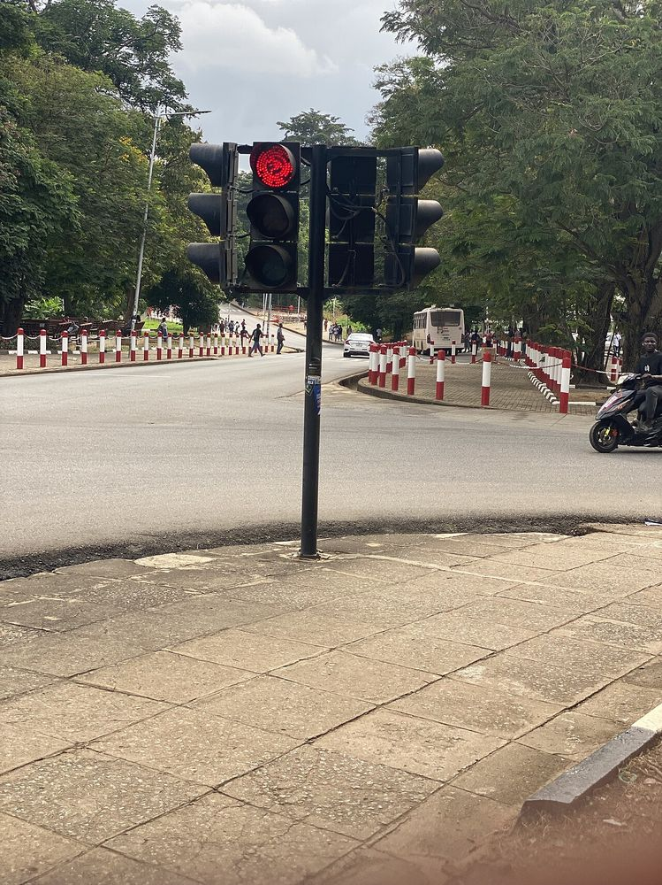

> 素材说明：两本书的全文我都没有读完。这篇笔记依据的材料有：两本书的出版社页面和中英文目录（耶鲁大学出版社、中信出版社、浙江人民出版社/湛庐、台湾天下文化、大块文化），平克的官网和他在 TED 的演讲（英文原稿，以及 TED 官方的繁体、简体中文字幕），格尼茨在 Adam Grant 播客《ReThinking》里的访谈文字稿，几篇原始论文（格尼茨本人主页上的 PDF、PubMed 和期刊摘要），还有天下文化与台湾读书博主的书评。凡是加引号的句子，都能在下文「参考资料」里找到出处；书里的原话我只引用出版社或可靠二手来源公开刊出的部分，没有凭印象"复原"任何一句。


<figure>

<figcaption>图片：Raizkgh / <a href="https://commons.wikimedia.org/wiki/File:Traffic_light.jpg">Wikimedia Commons</a>，<a href="https://creativecommons.org/publicdomain/zero/1.0/">CC0</a>。激励像信号灯：颜色清楚时有效，互相矛盾时事故就来了。</figcaption>
</figure>

## 一、两本书的基本信息

| | 《混合信号》 | 《驱动力》 |
|---|---|---|
| 原书 | *Mixed Signals: How Incentives Really Work*，Yale University Press，2023（精装 ISBN 9780300255539；平装 2024-03-26，ISBN 9780300276749，320 页） | *Drive: The Surprising Truth About What Motivates Us*，Riverhead Books，2009 |
| 作者 | Uri Gneezy，加州大学圣迭戈分校 Rady 管理学院行为经济学讲席教授，与 John List 合著《隐性动机》（*The Why Axis*） | Daniel H. Pink，美国商业与行为科学畅销书作家，另著 *A Whole New Mind*、*When* 等 |
| 简体版 | 《混合信号：激励是如何发挥作用的》，[美] 尤里·格尼茨著，江生、于华译，中信出版社 2023-11，ISBN 9787521756319，328 页 | 《驱动力：在奖励与惩罚都已失效的当下，如何焕发人的热情》，[美] 丹尼尔·平克著，龚怡屏译，湛庐策划、浙江人民出版社 2018-06（经典版），ISBN 9787213087486，223 页 |
| 繁体版 | 《誘因設計：精準傳遞訊號，讓人照著你的想法行動》，尤里．葛尼奇著，周宜芳译，天下文化 2023-10-27，ISBN 9786263554528，352 页 | 《動機，單純的力量：把工作做得像投入嗜好一樣 有最單純的動機，才有最棒的表現》，丹尼爾．品克著，席玉蘋译，大块文化 2010 年初版，ISBN 9789570316445，280 页 |
| 一句话 | 所有激励本质上都是信号，问题出在信号互相打架 | 驱动力 3.0：自主、专精、目的 |

简体版基本直译原书名，繁体版则改动更大：《誘因設計》的副标题直接点出"訊號"，把全书的核心概念摆上了封面。《驱动力》在台湾叫《動機，單純的力量》，副标题"把工作做得像投入嗜好一樣"，强调的是"心流"那一面。平克的三要素 autonomy、mastery、purpose，简体版目录译作"自主、专精、目的"，台湾读者书评引用的繁体版译法也是"自主、專精、目的"；TED 官方繁体字幕则译作"自主性、掌握度、使命感"。同一套概念，中文措辞相差不小。

另外，《混合信号》的简体版和繁体版章节标题并不一一对应。比如简体第 5 章叫"鼓励创新却惩罚失败"，繁体对应章节叫"鼓勵創新 vs. 迴避風險"。繁体版用"A vs. B"的句式，冲突感更强。

## 二、两本书各自讲了什么

### 《驱动力》：胡萝卜加大棒为什么过时

平克把人类动机分为三代。驱动力 1.0 是生物本能（饿了要吃）。驱动力 2.0 是奖惩，也就是"做了 X 就给 Y"的 if-then 奖励。驱动力 3.0 是内在动机。官网的摘要写道，数十年的研究表明 if-then 奖励"can reduce performance, crush creativity, and dampen long-term motivation – especially for complex or creative tasks"。

全书分三部分：
- **第一部分**：驱动力 3.0 时代来临，包括"奖励的惩罚，胡萝卜大棒失效了"和"做 I 型人还是 X 型人"。
- **第二部分**：三大要素。自主（"我做什么，我决定"）、专精（"把想做的事情做得越来越好"）、目的（"超越自身的渴望"）。
- **第三部分**：I 型工具箱。

平克官网列出的 Kindle 高亮里，有一句对工程管理很有用："Autonomy over four aspects of work: what people do, when they do it, how they do it, and whom they do it with." 也就是任务、时间、方法、团队四个维度的自主。

2009 年的 TED 演讲《The puzzle of motivation》是这本书的浓缩版。演讲中他讲了 Glucksberg 的蜡烛问题：一组被告知"最快的 25% 得 5 美元，最快的人得 20 美元"，结果比对照组平均慢了三分半钟。繁体字幕是这样译的："答案：是慢了三分半鐘"。他的解释是，奖励会让人聚焦，适合答案就在眼前的任务；可蜡烛问题需要四处寻找灵感，"獎勵只會收窄我們的視線，限制了可能性"。

演讲最后的总结，繁体字幕是："第一：那些二十世紀的獎勵方式……只能在一個比我們想像更狹窄的環境下發揮作用，第二：那種「因果」式的獎勵往往摧毀創意，第三：提高工作表現的祕訣，不在獎與罰，而是在見不到的內在動力"。

### 《混合信号》：激励是会说话的

格尼茨的出发点完全不同。他不是心理学家，而是做田野实验的经济学家。耶鲁出版社页面引用了全书的一句核心话："Incentives send a signal ... and your objective is to make sure this signal is aligned with your goals."

天下文化的简介给"混合信号"下了定义："所提供的誘因，其發出的訊號原本應該是為了獎勵A行為，最後卻鼓勵了B行為"。

全书分七部分 28 章，引言叫"照我说的做，别学我的样儿"。我最关心的是第二部分"避免混合信号"，四章分别是：
- 以质量为代价激励数量
- 鼓励创新却惩罚失败
- 鼓励长期目标却奖励短期成果
- 鼓励团队合作却激励个人成功

这几乎就是技术团队绩效制度的四大病。后面几部分讲激励如何塑造故事（风险与错误、心理账户、作为信号的奖励）、用激励诊断问题（比如"有偿离职"）、改变习惯，以及在马赛社区用激励改变猎狮、割礼等文化习俗。最后讲谈判中的信号（锚定、价格传递质量信号）。

在 Adam Grant 的播客里，格尼茨举了公交司机的例子：管理层说要安全驾驶、乘客满意，但工资按载客数算，那么司机读到的信息就是"其实就是要多拉客"。他说："I really pick up the signals of what does it mean to be a good driver or a good employee ... from the incentives that are out there." 他还补充："you cannot have a situation without incentives"。不设激励也是一种激励，现状本身就带着信号。

台湾博主"西恩的閱讀筆記"的总结很到位。书里把激励分成两类：直接的经济效应（钱、罚款），和间接的社会信号与自我信号。"社會訊號"是在意别人怎么看我，"自我訊號"是维持内心的自我形象。

## 三、两本书共享的证据，我逐条核对了

两本书引用的经典研究大量重叠，而且其中几篇格尼茨本人就是作者。我把原始文献找出来对了一遍。

**1. 托儿所罚款：「A Fine is a Price」**（Gneezy & Rustichini，*Journal of Legal Studies* 2000）
- 实验在海法 10 家私立托儿所进行，时间是 1998 年 1 至 6 月，共 20 周。
- 从第 5 周起，6 家托儿所对迟到 10 分钟以上的家长罚款 10 新谢克尔，另外 4 家作对照。
- 结果迟到的家长不减反增，稳定在初始水平的"almost twice"。第 17 周取消罚款后，迟到率也没有回落。
- 论文的解释是：罚款被引入一个"不完全契约"，它改变了家长掌握的信息。迟到原本是一件说不清有多糟的事，现在被标上了价格，"No guilt or shame"。
- 格尼茨在播客里的说法更直白："Now that you told me that it's $3 bad, now I don't care." 他还说这件事最初来自自己女儿上托儿所的亲身经历。

**2. 「Pay Enough or Don't Pay at All」**（Gneezy & Rustichini，*QJE* 2000）
- IQ 测试：每答对一题付 10 美分的组，平均答对 23.07 题，比不付钱的组（28.4）还低。付 1 或 3 新谢克尔的组则升到 34 题左右，两者之间没有显著差异。
- 募捐：高中生上门募捐，拿 1% 提成的组只募到 153.6，比纯义务组的 238.6 少得多。提成提到 10%，募到 219.3，仍然没超过义务组。
- 结论就是标题：要么给够，要么别给。给一点点钱，等于告诉对方"这事就值这么点"。

**3. Deci 1971**（*JPSP* 18(1):105–115）
- 实验让 24 名心理学导论课的学生（实验组、对照组各 12 人）分三次玩 Parker Brothers 出的 Soma 立体拼图。第二次只给实验组按完成情况付钱，第三次撤掉报酬，观察大家在自由时间里还愿不愿意继续玩。
- 摘要的结论是：用钱作外部奖励时，内在动机倾向于下降；用口头强化和正面反馈时，内在动机倾向于上升。
- 我在原文第 107 页读到一段几乎就是格尼茨理论雏形的话：金钱奖励的存在"suggests to the subjects that they 'should probably not render this activity without pay'"。早在 1971 年，Deci 就把挤出效应解释成"奖励传递了关于这件事性质的信息"。这是两本书最自然的交汇点。
- Deci 和 Ryan 此后发展出自我决定理论（SDT）。官网的表述是：支持自主（autonomy）、胜任（competence）、关系（relatedness）三种基本心理需要的环境，会带来最高质量的动机。平克的"自主、专精、目的"基本是把 SDT 的前两项拿来，再把"关系"换成了"目的"。

**4. 高额奖励与"大错"**（Ariely、Gneezy、Loewenstein & Mazar，*Review of Economic Studies* 2009）
- 这正是平克 TED 里讲的"麻省理工研究 + 印度马杜赖复现"。论文在印度乡村设了 4、40、400 卢比三档奖励，最高一档单个游戏的满额奖金（400 卢比）已接近当时印度农村人均月消费支出（495 卢比）。
- 摘要原话："With some important exceptions, very high reward levels had a detrimental effect on performance."
- 但论文同时报告，在纯体力的按键任务上，高奖励确实提高了表现。所以准确的说法是：高额奖励伤害需要认知技能的任务，而不是伤害一切任务。

## 四、争议：挤出效应到底有多普遍

平克的书写得像一场"科学对企业"的审判，但学术界对挤出效应争论了二十多年，远不止一边倒。

- **Cameron & Pierce（1994，*Review of Educational Research*）**：对 96 项实验做元分析，摘要结论是"overall, reward does not decrease intrinsic motivation"。口头表扬会提高内在动机，唯一的负面效应出现在"为了完成任务本身而给予的预期有形奖励"上，而且只是"minimal negative effect"。
- **Deci、Koestner & Ryan（1999，*Psychological Bulletin*）**：用 128 项研究反驳。结论是，与参与、完成、表现挂钩的有形奖励都会显著削弱自由选择情境下的内在动机（d 约为 −0.40、−0.36、−0.28），对儿童伤害更大；但正面反馈会增强内在动机（d = 0.33）。同一期附了大量评论与回应，可见争论之激烈。
- **Cerasoli、Nicklin & Ford（2014，*Psychological Bulletin*）**：这是我认为最有调和价值的一项。它覆盖 183 个样本、21 万余人，发现内在动机能预测绩效，而且在"质量"上预测力更强；外部激励则更能预测"数量"。挤出效应主要出现在激励与绩效直接挂钩、高度显著的情况下。作者的结论是二者"not necessarily antagonistic"。Adam Grant 在播客里也是这么概括的：激励更擅长让人更努力，而不是更聪明。

所以，平克说"if-then 奖励往往摧毁创意"，这个说法在实验室的创造性任务上有证据，但推到"奖金和 KPI 在知识工作中普遍失效"就过度概括了。格尼茨的框架恰好能解释两边的数据为什么都成立：同样是钱，传递的信号不同，结果就不同。

## 五、整合：激励 = 经济价格 + 信号

我把两本书合成一张图：

```
                 一项激励（奖金 / 罚款 / 指标 / 晋升标准）
                                  │
          ┌───────────────────────┴───────────────────────┐
          ▼                                               ▼
   直接效应：价格                                    间接效应：信号
   （格尼茨 / 标准经济学）                           （格尼茨 + Deci + 平克）
   做 X 更划算 → 做更多 X                                  │
                               ┌──────────────────────┼──────────────────────┐
                               ▼                      ▼                      ▼
                         关于任务的信号         关于我的信号           关于你的信号
                       "这事值多少/有多糟"   "我是因为钱才做"       "组织真正在乎什么"
                        托儿所罚款              Deci 1971               公交司机、20% 时间
                        给一点点钱              自我信号/身份           混合信号四大病
                               │                      │                      │
                               └──────────────────────┼──────────────────────┘
                                                      ▼
                     信号与内在动机（自主 / 专精 / 目的）一致 → 互相加强
                     信号与内在动机冲突 → 挤出（平克说的"奖励的惩罚"）
```

| 问题 | 平克的回答 | 格尼茨的回答 | 我的整合 |
|---|---|---|---|
| 激励为什么会失效？ | 外部奖励把"玩"变成"活"，挤出内在动机 | 激励发出的信号和你嘴上说的目标相反 | 挤出是信号失败的一种特例：信号告诉对方"你是为钱干活的" |
| 什么时候钱有用？ | 常规、算法型任务 | 给够、信号清晰、与目标一致时 | 数量型、可度量的任务直接用；质量型、创造性任务，先检查信号 |
| 应该怎么设计？ | 给自主、专精、目的；先把基本报酬给公平，"把钱的问题移出桌面" | 先画出激励会引发的行为树，确保"放进誘因的，確實是你想要鼓勵的事物" | 先付公平的基本报酬，再用非控制性的反馈与认可做信号，最后才谨慎用 if-then |
| 正面反馈呢？ | 鼓励"now-that"式的事后、非预期认可 | 奖励本身就是信号，可以表达尊重 | Deci 等人 1999 年的元分析：正面反馈 d = 0.33，是最便宜的强信号 |

一句话：**平克告诉你"什么"会被挤出，格尼茨告诉你"为什么"会被挤出，以及如何不被挤出。**

## 六、放到工程团队里

下面几条是我结合两本书，给技术负责人列的诊断方法。每一条都先问同一个问题：**这项激励到底在对工程师"说"什么？**

**1. OKR / KPI**
- 混合信号：说"质量第一"，却按功能交付数、故事点、PR 数量考核。这正是格尼茨第 4 章的"以质量为代价激励数量"。
- 做法：KPI 用于观察系统，不用于直接发钱。OKR 保持"有挑战、可失败"的定位，和奖金脱钩；否则大家会把目标往低处定，这本身就是理性回应信号。

**2. 奖金与绩效评级**
- 两本书在这里意见一致：基本报酬要公平且有竞争力。平克要先"把钱的问题移出桌面"，格尼茨要"给够"。只给一点点钱的"优秀奖"，最容易落入"给一点点等于告诉你这事不值钱"的陷阱。
- 团队目标配个人奖金，就是第 7 章的"鼓励团队合作却激励个人成功"。如果工作高度依赖协作，就让奖金池的一部分与团队结果挂钩，并在评审中明确评价帮助他人、带新人、做 code review 这类"不显眼的贡献"。

**3. On-call 补贴**
- On-call 应该付钱，这是对打扰的补偿。但要小心"按事故次数付钱"：这会发出"事故越多越好"的信号，跟托儿所罚款反过来是同一个道理。
- 更好的做法是按值班时长付固定补贴，同时把"减少告警噪音、写 runbook"算作专精和晋升证据，让人从中得到"我在变得更好"的自我信号。

**4. Bug bounty 与内部质量奖**
- 对外部白帽，赏金是清晰的价格信号，效果很好。对内部员工按 bug 数发奖，则可能产生"自己埋雷自己挖"的经典反效果；即便没人作弊，也在告诉大家"质量是额外的活"。
- 做法：内部更多用公开认可和事后的"now-that"奖励，不事先承诺按件计酬。

**5. Code review 指标**
- 统计"每人 review 了多少 PR、平均响应时长"，很快就会出现秒批的 LGTM。这是典型的数量挤出质量。
- 做法：指标只给团队看趋势，不排名；把"一次有深度的 review"当作专精来认可，比如在周会上点评一条好评论。

**6. 20% 时间 / 黑客日**
- 平克在 TED 中盛赞 Atlassian 的"FedEx 日"和谷歌的 20% 时间。但 Quartz 在 2013 年报道，谷歌 20% 时间已经"as good as dead"。原因很有意思：项目要经理批准，而经理按团队生产力被考核，考核又默认员工 100% 时间都在主业上。
- 这是一个教科书级的混合信号：嘴上给自主，考核却在惩罚自主。想做 20% 时间，必须同步调整经理的考核口径，否则不如不做。

**7. 失败与创新**
- 格尼茨第 5 章"鼓励创新却惩罚失败"。他在播客里说："you try to innovate, you fail ... and then they punish you"。
- 做法：事故复盘对事不对人，实验失败不进绩效扣分项，而且要让大家看到真实的例子。比如一个失败的重构提案仍被写进晋升材料，比一百次口号都管用。

**8. 职级阶梯与专精**
- 专精需要"可见的进步"。一份清晰的工程职级说明，本身就是最强的专精信号：它告诉大家组织在乎什么样的成长。
- 要注意，如果职级说明写的是"技术深度"，实际晋升看的却是"带了多大的项目"，大家就会去抢项目而不是磨手艺。

**9. 自主的四个维度**
- 用平克的"任务、时间、方法、团队"四维度做一次自查：工程师能否选择技术方案？能否调整自己的工作时间？能否参与选题？能否换组？每多一个"不能"，就该问一句：这条限制是必要的，还是习惯？

## 七、我的思考：两本书的局限

**《驱动力》的问题**
1. **证据被讲成了故事。** 平克把实验室里的创造性任务结论推广到整个"21 世纪的工作"，跳过了 Cameron & Pierce 和 Cerasoli 等人的反面与调和证据。TED 里"谷歌差不多一半的新产品都诞生于 20% 时间"这类说法，也缺少严格的数据支撑。
2. **I 型/X 型的二分太干净。** 格尼茨在播客里说得好：心理学家说人上班是为了意义，经济学家说是为了交房租，"these two strawmen are just strawmen"。
3. **"把钱移出桌面"说起来容易。** 在薪酬不透明、差距大的组织里，钱永远在桌面上。

**《混合信号》的问题**
1. **框架太宽，几乎什么都能解释。** "一切激励都是信号"很有洞察力，但几乎可以事后解释任何结果。要让它有用，必须事先写下"我预期对方会读到什么信号"，并用实验检验。格尼茨本人倡导小规模测试，读者却容易只记住故事。
2. **案例多，组织层面的系统设计少。** 台湾读者的书评也指出，书名像是教"怎么设计"，"其實更多是用非常多的例子"，告诉你混合信号会带来什么后果。
3. **田野实验的外推。** 托儿所、募捐、马赛社区的结论，搬到一家 500 人的软件公司能保留多少，需要自己验证。

**两本书都没有充分讨论的**
- 信号是被"读"出来的，读法受文化、信任和历史影响。同一笔奖金，在一个刚裁过员的团队里，信号完全不同。
- 激励的设计者通常也处在激励之中。经理有自己的 KPI，这才是 20% 时间失败的真正原因。

## 八、可执行清单

设计或调整任何一项激励前，逐条过一遍：

- [ ] **写下目标行为**：我希望大家多做什么、少做什么？质量还是数量？
- [ ] **写下信号**：站在一名普通工程师的角度，这项激励在"说"什么？会不会和我们嘴上说的相反？
- [ ] **检查四类混合信号**：数量 vs 质量、创新 vs 惩罚失败、长期 vs 短期、团队 vs 个人。
- [ ] **金额检查**：要么给够，要么不要给钱，改用认可、机会或时间。
- [ ] **任务类型检查**：常规、可度量的任务可以用 if-then；探索性、创造性的任务优先保障自主、专精、目的，奖励放在事后、不事先承诺。
- [ ] **画行为树**：如果有人钻空子，最便宜的钻法是什么？
- [ ] **检查设计者自己的激励**：经理、HR 的考核是否会让这项政策名存实亡？
- [ ] **反馈优先**：有没有更便宜的方法，例如具体、及时、非控制性的正面反馈？
- [ ] **小范围试点**：先在一个团队试一个周期，带对照组和退出条件。
- [ ] **撤销预案**：托儿所告诉我们，撤掉一个坏激励并不能让行为自动恢复，上线前要想好怎么收场。

## 参考资料

**书籍信息**
- Yale University Press, *Mixed Signals: How Incentives Really Work*（平装与电子版页面）：<https://yalebooks.yale.edu/book/9780300276749/mixed-signals/>
- Google Books, *Mixed Signals*（精装 ISBN 9780300255539）：<https://books.google.com/books/about/Mixed_Signals.html?id=k7JI0QEACAAJ>
- 豆瓣读书，《混合信号：激励是如何发挥作用的》（中信出版社）：<https://book.douban.com/subject/36623489/>
- 豆瓣读书，《誘因設計》（天下文化）：<https://book.douban.com/subject/36622217/>
- 天下文化 Bookzone，《誘因設計》：<https://bookzone.cwgv.com.tw/book/BCB817>
- Daniel Pink 官网，*Drive*：<https://www.danpink.com/books/drive/>
- 湛庐文化，《驱动力》新版页面：<https://www.cheerspublishing.com/book/detail/1651107448999563264>
- 诚品，《動機，單純的力量》（大块文化）：<https://www.eslite.com/product/1001129721961311>
- 豆瓣读书，《動機，單純的力量》：<https://book.douban.com/subject/5288336/>

**演讲与访谈**
- Dan Pink, "The puzzle of motivation", TEDGlobal 2009（含繁体、简体中文字幕）：<https://www.ted.com/talks/dan_pink_the_puzzle_of_motivation>
- ReThinking with Adam Grant, "How do incentives really work? with Uri Gneezy"（文字稿）：<https://www.ted.com/podcasts/rethinking-with-adam-grant/how-do-incentives-really-work-with-uri-gneezy-transcript>
- The Brainy Business 播客第 273 期，"Mixed Signals: How Incentives Really Work, with Uri Gneezy"：<https://thebrainybusiness.com/podcast/273-mixed-signals-how-incentives-really-work-with-uri-gneezy/>

**原始研究**
- Gneezy & Rustichini (2000), "A Fine is a Price", *Journal of Legal Studies* 29(1):1–17：<https://rady.ucsd.edu/_files/faculty-research/uri-gneezy/fine.pdf>（DOI 页：<https://www.journals.uchicago.edu/doi/10.1086/468061>）
- Gneezy & Rustichini (2000), "Pay Enough or Don't Pay at All", *QJE* 115(3):791–810：<https://rady.ucsd.edu/_files/faculty-research/uri-gneezy/pay-enough.pdf>
- Gneezy, Meier & Rey-Biel (2011), "When and Why Incentives (Don't) Work to Modify Behavior", *JEP* 25(4):191–210：<https://www.aeaweb.org/articles?id=10.1257/jep.25.4.191>
- Ariely, Gneezy, Loewenstein & Mazar (2009), "Large Stakes and Big Mistakes", *Review of Economic Studies* 76(2):451–469：<https://people.duke.edu/~dandan/webfiles/PapersUpside/Large%20Stakes%20Big%20Mistakes.pdf>
- Deci (1971), "Effects of externally mediated rewards on intrinsic motivation", *JPSP* 18(1):105–115：<https://selfdeterminationtheory.org/SDT/documents/1971_Deci.pdf>（DOI：<https://doi.org/10.1037/h0030644>）
- Glucksberg (1962), "The influence of strength of drive on functional fixedness and perceptual recognition", *Journal of Experimental Psychology* 63:36–41：<https://pubmed.ncbi.nlm.nih.gov/13899303/>
- Cameron & Pierce (1994), "Reinforcement, Reward, and Intrinsic Motivation: A Meta-Analysis", *Review of Educational Research* 64(3):363–423：<https://journals.sagepub.com/doi/10.3102/00346543064003363>
- Deci, Koestner & Ryan (1999), *Psychological Bulletin* 125(6):627–668：<https://pubmed.ncbi.nlm.nih.gov/10589297/>
- Cerasoli, Nicklin & Ford (2014), *Psychological Bulletin* 140(4):980–1008：<https://pubmed.ncbi.nlm.nih.gov/24491020/>
- Self-Determination Theory 官网，Theory 概述：<https://selfdeterminationtheory.org/theory/>

**报道与书评**
- Quartz (2013), "Google's '20% time,' which brought you Gmail and AdSense, is now as good as dead"：<https://qz.com/115831/googles-20-time-which-brought-you-gmail-and-adsense-is-now-as-good-as-dead>
- 西恩的閱讀筆記，【超閱讀觀點】《誘因設計》：<https://seanreads.com/mixed-signals-how-incentives-really-work/>
- Angela Watson, "Responsible rewards: using the 'now-that' principle with students"（引述《驱动力》对 if-then 与 now-that 奖励的区分）：<https://truthforteachers.com/truth-for-teachers-podcast/responsible-rewards-using-now-principle-students/>
- 托馬斯的社群咖啡館，閱讀心得《動機，單純的力量》：<https://vocus.cc/article/6906a023fd897800014f3c6a>
