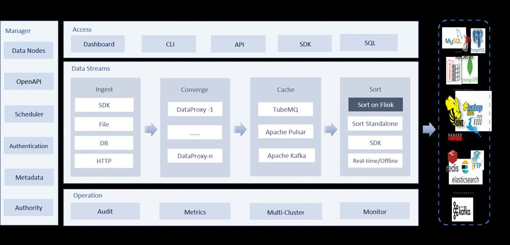
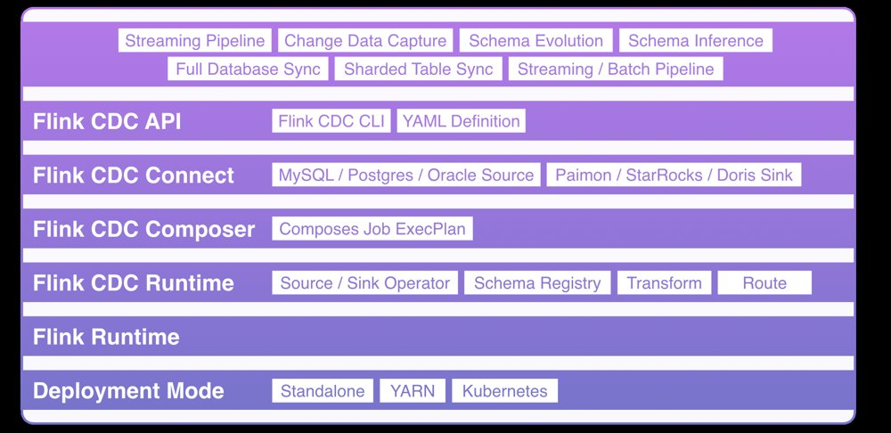

> **调研边界（请先读）**：本文只讨论同时满足下列条件的开源项目——① 有 Web 页面可配置任务；② 源端至少覆盖 **MySQL 与 SQL Server**；③ 目标端覆盖 **Kafka、Apache Doris、ClickHouse**（或可明确组合达成）；④ 支持 **全量 + 增量**（CDC / binlog / CDC 日志类，而非仅定时 JDBC 批抽）；⑤ GitHub **stargazers_count > 1000**；⑥ OSI/ASF 友好开源许可（Apache-2.0 等）。Star、license、最近 push 一律以 `gh api repos/<owner>/<repo>` 在 **2026-11-05** 拉取为准；功能以官方文档页面为准，**不凭记忆断言**。未能打开或无法交叉验证的点，会在文末「未能核实」列出。

<figure>

<figcaption>图片：Apache SeaTunnel 官网 <a href="https://seatunnel.apache.org/image/logo.png">logo.png</a>；项目许可证 <a href="https://github.com/apache/seatunnel/blob/dev/LICENSE">Apache-2.0</a>。已压缩并本地托管于本站 <code>static/images/…</code>。</figcaption>
</figure>

## 一、问题怎么拆

业务侧常见诉求可以写成一条链路：

```
[OLTP] MySQL / SQL Server
        |  (snapshot 全量 + binlog/CDC 增量)
        v
   同步引擎 / 平台 (+ Web 配置)
        |
        +--> Kafka（总线 / 解耦）
        +--> Apache Doris（分析型 OLAP）
        +--> ClickHouse（列存分析）
```

工程上真正卡人的通常不是「能不能连上」，而是：

1. **有没有 Web**：运维/数据同学是否必须手写 YAML / Flink SQL。
2. **SQL Server 是否一等公民**：很多「国产 CDC」其实只做深了 MySQL。
3. **三目标是否原生 sink**：Kafka / Doris / ClickHouse 缺一就会被迫叠两套栈。
4. **全量切增量是否平滑**：`startup.mode=initial`、checkpoint、exactly-once、DDL。
5. **许可证与 star**：商业分发、二次开发、社区活跃度。

跨地域补充一句：若同步链路两端跨大洲（例如控制面/作业在新加坡、Doris 在墨西哥），RTT 与跨洋带宽会放大 checkpoint 与 Stream Load 延迟；选型时优先选**可把 sink 写路径贴近目标集群**、或**中间以同区域 Kafka 解耦**的架构，而不是只看功能 checklist。

## 二、入选项目（满足或「组合满足」）

下表 star / license / 最近 push 均为 **2026-11-05** 经 GitHub REST API 核实（UTC 时间已换算备注）。

| 方案 | 仓库 | Stars | License | 最近 push (UTC) | Web | MySQL | SQL Server | Kafka | Doris | ClickHouse | 全量+增量 |
|------|------|------:|---------|-----------------|-----|-------|------------|-------|-------|------------|-----------|
| SeaTunnel + SeaTunnel Web | [apache/seatunnel](https://github.com/apache/seatunnel) + [apache/seatunnel-web](https://github.com/apache/seatunnel-web) | **9788** / **888** | Apache-2.0 | 2026-11-04 / 2026-01-22 | ✅ Web（独立仓） | ✅ MySQL-CDC | ✅ SqlServer-CDC | ✅ | ✅ | ✅ | ✅ `startup.mode=initial` |
| Apache InLong | [apache/inlong](https://github.com/apache/inlong) | **1507** | Apache-2.0 | 2026-09-16 | ✅ Dashboard | ✅ Extract | ✅ Extract | ✅ Load | ✅ Load | ✅ Load | ✅ 同步场景 |
| Flink CDC + Dinky | [apache/flink-cdc](https://github.com/apache/flink-cdc) + [DataLinkDC/dinky](https://github.com/DataLinkDC/dinky) | **6492** / **3779** | Apache-2.0 | 2026-11-05 / 2026-10-22 | ⚠️ CDC 本身无 Web；Dinky 提供 | ✅ | ✅ Pipeline 3.7 | ✅ Pipeline sink | ✅ Pipeline sink | ⚠️ Pipeline 无官方 CH sink，需 Flink SQL/其他 | ✅ |
| Flink CDC + StreamPark | 同上 + [apache/streampark](https://github.com/apache/streampark) | **6492** / **4346** | Apache-2.0 | 同上 / 2026-10-31 | ⚠️ 同上，StreamPark 管 Flink 作业 | ✅ | ✅ | ✅ | ✅ | ⚠️ 同上 | ✅ |
| TIS | [datavane/tis](https://github.com/datavane/tis) | **1440** | Apache-2.0 | 2026-11-04 | ✅ Console | ✅ Flink-CDC + DataX | ✅ Flink-CDC + DataX | ✅ | ✅ | ✅ | ✅ 批量 DataX + 实时 Flink-CDC |

> **关于 SeaTunnel Web 888★**：单独未过 1k，但它是 ASF 官方 Web 控制台，与引擎同属 SeaTunnel 生态；本文按「引擎 star>1k + 官方 Web」入选，并在对比里标明 Web 仓活跃度（最近 push 停在 2026-01，需关注版本绑定）。

### 1. Apache SeaTunnel（+ SeaTunnel Web）

**能力依据（文档）**：

- MySQL CDC：支持 snapshot + 增量，`startup.mode` 含 `initial`（先历史后增量），可选 exactly-once、schema-changes。[MySQL-CDC 文档](https://seatunnel.apache.org/docs/2.3.11/connector-v2/source/MySQL-CDC/)
- SQL Server CDC：[SqlServer-CDC](https://seatunnel.apache.org/docs/2.3.11/connector-v2/source/SqlServer-CDC/)
- Sink： [Kafka](https://seatunnel.apache.org/docs/2.3.11/connector-v2/sink/Kafka/)、[Doris](https://seatunnel.apache.org/docs/2.3.11/connector-v2/sink/Doris/)、[Clickhouse](https://seatunnel.apache.org/docs/2.3.11/connector-v2/sink/Clickhouse/) 均有独立文档页（HTTP 301→正式路径，已确认存在）。
- Web： [seatunnel-web README](https://github.com/apache/seatunnel-web/blob/main/README.md) 描述为管理脚本、数据源、任务并提交到 Zeta Engine；默认 UI `http://127.0.0.1:8801/ui/`（admin/admin）。**Web 与引擎版本强绑定**，部署要求客户端与 Server 同 OS/同目录结构。

**架构示意**：

```
Browser ──► SeaTunnel Web (8801)
                │  submit job
                v
         SeaTunnel Zeta Cluster
      (MySQL-CDC / SqlServer-CDC)
                │
        ┌───────┼────────┐
        v       v        v
     Kafka    Doris   ClickHouse
```

**适合**：希望「一个引擎覆盖三目标」、团队接受 Zeta/Flink 引擎运维、中文文档友好。  
**坑**：Web 仓 star 与活跃度弱于引擎；插件 jar / `plugin-mapping.properties` / `SEATUNNEL_HOME` 配置易踩坑；CDC 权限（REPLICATION）与 GTID/binlog 格式要按文档开。

### 2. Apache InLong

<figure>

<figcaption>图片：Apache InLong 官方文档架构图 <a href="https://inlong.apache.org/img/inlong-structure-en.png">inlong-structure-en.png</a>（见 <a href="https://inlong.apache.org/docs/introduction/">Introduction</a>）；Apache-2.0。本地压缩托管。</figcaption>
</figure>

**能力依据**：[Introduction - Supported Data Nodes](https://inlong.apache.org/docs/introduction/) 明确列出：

- Extract：MySQL、**SQLServer**（2012–2019）等  
- Load：**Kafka、Doris、ClickHouse** 等  
- 模块含 **inlong-dashboard**（前端管控）、Manager、Sort、Agent 等  

最新 release 标签 API 见 `2.4.0-RC0`（2026-08-21）；仓库 push 至 2026-09-16，活跃度中等。

**适合**：需要「接入 + 同步 + 订阅」一体、已有或愿意上 TubeMQ/Pulsar/Kafka 作为中间缓冲、偏腾讯系大数据栈。  
**坑**：完整架构组件多（Agent/DataProxy/MQ/Sort/Manager/Dashboard/Audit），轻量模式可用 Sort+Manager+Dashboard，但仍比「单二进制同步工具」重；运维成本要提前评估。

### 3. Flink CDC + Dinky / StreamPark（组合方案）

<figure>

<figcaption>图片：来自 <a href="https://github.com/apache/flink-cdc">apache/flink-cdc</a> 文档静态资源 <code>docs/static/fig/architecture.png</code>（Apache-2.0）。本地压缩托管。</figcaption>
</figure>

**能力依据**：

- Flink CDC **本身无 Web UI**（官方定位是库/连接器 + Pipeline YAML）。
- Pipeline Connectors Overview（stable / 3.7）：Source 含 **MySQL、SQL Server**；Sink 含 **Kafka、Doris** 等；**未列出 ClickHouse pipeline sink**。[Overview](https://nightlies.apache.org/flink/flink-cdc-docs-stable/docs/connectors/pipeline-connectors/overview/)
- 写 ClickHouse 需走 **Flink SQL Connector / JDBC / 第三方**，不算「Pipeline 一等 sink」，本文标 ⚠️。
- Web 层：
  - [Dinky](https://github.com/DataLinkDC/dinky)（3779★）：FlinkSQL 开发平台，支持 CDCSOURCE 等作业管理（中文社区活跃）。
  - [StreamPark](https://github.com/apache/streampark)（4346★，Apache-2.0）：Flink/Spark 应用管理平台。

最新 Flink CDC release：`release-3.7.0`（2026-10-10）。

**适合**：已有 Flink 平台、要强一致性/复杂转换、接受「CDC 引擎 + 作业平台」两件套。  
**坑**：ClickHouse 需额外确认连接器版本矩阵；SQL Server CDC 要开库级 CDC、清理 job；平台与 Flink/CDC 版本矩阵要锁死。

### 4. TIS（datavane/tis）

**能力依据**：[tis.pub 文档「支持的端类型」](https://tis.pub/docs/) 表格（核实于 2026-11-05）显示：

- **SqlServer**：DataX 读/写 + **Flink-CDC Source** + ChunJun Sink  
- **MySQL**：同上  
- **Kafka**：DataX 与实时 Pipeline sink  
- **Doris**：DataX 读/写 + ChunJun 实时 Sink；文档有「MySQL 同步 Doris」实时 Demo  
- **Clickhouse**：DataX Writer + ChunJun 实时 Sink；有「MySQL 导入 Clickhouse」视频示例  

底层明确写为 **DataX / Flink-CDC**（及 ChunJun）+ Web Console，满足「有 Web 配全量+增量」。

**适合**：要强 Web/零代码、中文资料全、愿意绑定 TIS 插件生态与 Flink 集群。  
**坑**：插件/SPI 体系学习曲线；实时链路实际依赖 Flink 集群质量；社区体量小于 SeaTunnel/Flink CDC 主仓。

## 三、横向对比（工程维度）

| 维度 | SeaTunnel+Web | InLong | Flink CDC+Dinky/StreamPark | TIS | DBSyncer 2.1.6（★954，未过 1k） |
|------|---------------|--------|----------------------------|-----|--------------------------------|
| Web 配置成熟度 | 可用，但 Web 仓活跃偏弱 | Dashboard 一等公民 | 取决于 Dinky/StreamPark | Console 强，偏零代码 | ✅ 内置 Thymeleaf 控制台 |
| 源：MySQL / SQL Server | 双 CDC 文档齐全 | Extract 节点表齐全 | Pipeline 3.7 双源 | Flink-CDC + DataX | ✅ binlog / ✅ CDC(LSN) |
| 目标三件套 | 三 sink 均有官方页 | 三 Load 均列出 | Kafka+Doris 原生；CH ⚠️ | 三端均在端类型表 | ✅ Kafka；✅ Doris Stream Load；✅ CH 写（源=游标） |
| 全量→增量 | `startup.mode=initial` | 同步场景支持 | Snapshot + binlog/CDC | DataX 全量 + Flink 增量 | ✅ FullIncrementPuller 钉位点 |
| DDL / Schema | `schema-changes.enabled`（有限） | 视 Sort/连接器 | Pipeline 演进中，需查版本文档 | 依赖底层 Flink-CDC/ChunJun | MySQL ALTER 事件有代码；e2e 未测 |
| 部署依赖 | Zeta 或 Flink + Web + DB | 多组件或轻量 Sort | Flink 集群 + 平台 | TIS + Flink(+DataX) | 单进程 + H2/MySQL；集群需验证 |
| 许可证 | Apache-2.0 | Apache-2.0 | Apache-2.0 | Apache-2.0 | Apache-2.0 |
| 中文/繁中资料 | 官网中英；iT 邦帮忙等有 CDC 概念文 | 中英文档 | 中文社区很强（Dinky） | 中文文档/视频丰富 | 中文官网/社区友好 |
| 典型坑 | Web/引擎版本锁；插件路径 | 组件多、运维重 | CH sink 非 pipeline；版本矩阵 | 插件版本与 Flink 对齐 | 默认 admin/admin；Boot 2.5/Kafka 0.11；无 GH Actions |

**繁体资料**：台湾 iT 邦帮忙有多篇 CDC 概念文（如 [变更资料撷取 CDC](https://ithelp.ithome.com.tw/articles/10362458)、[Change Data Capture](https://ithelp.ithome.com.tw/articles/10275451)），偏原理而非上述具体产品对比；产品级繁中文档仍以各项目官网中英为主。

## 四、未入选及原因（同样经核实）

| 项目 | Stars / License（2026-11-05） | 未入选主因 |
|------|-------------------------------|------------|
| [alibaba/canal](https://github.com/alibaba/canal)（+canal-admin） | 29746 / Apache-2.0 | **源端以 MySQL 为主**，不满足 SQL Server 一等需求 |
| [debezium/debezium](https://github.com/debezium/debezium) | 13317 / Apache-2.0 | 引擎强大，但官方 [debezium-ui](https://github.com/debezium/debezium-ui) **已 archived**（351★，MIT），无活跃一等 Web |
| [alibaba/DataX](https://github.com/alibaba/DataX) + [WeiYe-Jing/datax-web](https://github.com/WeiYe-Jing/datax-web) | 17382 / NOASSERTION；6023 / MIT | **批式同步为主，无真正 CDC 增量**（增量需另栈）；DataX-Web 最近 push 停在 2024-06 |
| [brokercap/Bifrost](https://github.com/brokercap/Bifrost) | 2092 / Apache-2.0 | **MySQL 生态**，不覆盖 SQL Server 条件 |
| [DTStack/chunjun](https://github.com/DTStack/chunjun) | 4106 / Apache-2.0 | 连接器能力强，但**本身不是完整 Web 配置平台**（常被 TIS 等托管） |
| [airbytehq/airbyte](https://github.com/airbytehq/airbyte) | 22317 / **ELv2 (NOASSERTION)** | **非 OSI 传统开源**（Elastic License 2.0）；Doris destination 社区状态需单独核（有 ARCHIVED 记录），不作为本清单首选 |
| [tapdata/tapdata](https://github.com/tapdata/tapdata) | **662** / Apache-2.0 | **star < 1k** |
| [86dbs/dbsyncer](https://github.com/86dbs/dbsyncer)（DBSyncer **v2.1.6**） | **954** / Apache-2.0 | **star < 1k**（门槛未过）；功能上 Web + MySQL binlog / SQL Server CDC → Kafka/Doris/ClickHouse + 全量+增量均有源码依据，见下文「特别分析」；勿与 [Zhh9126/DBSYNC](https://github.com/Zhh9126/DBSYNC)（2.1.4 重命名衍生）混淆 |
| [apache/hop](https://github.com/apache/hop) | 1519 / Apache-2.0 | ETL/可视化强，**CDC 通常外挂 Debezium**，非本条件「内建订阅三目标」主线 |
| CloudCanal（ClouGence） | 官方定位见 [cloudcanal-issue](https://github.com/ClouGence/cloudcanal-issue) | **社区版可免费使用但非开源**；明确剔除 |
| [lensesio/kafka-connect-ui](https://github.com/lensesio/kafka-connect-ui) | 519 | **star < 1k**，且只是 Connect 管理 UI，不是端到端 CDC 平台 |
| seatunnel-web **单独** | 888 | 不单独过 1k；仅作为引擎配套计入 |

## 四附、特别分析：DBSyncer 2.1.6（功能匹配，star 未过 1k）

> **口径**：仍列在「未入选」——本文硬门槛是 GitHub **stars > 1000**；2026-11-05 核实 [86dbs/dbsyncer](https://github.com/86dbs/dbsyncer) 为 **954★ / 156 forks / Apache-2.0**，最新 tag **`v2.1.6`**（annotated tag → commit `d0aa992e`，提交说明 `!621 pg增量调整`，UTC 2026-11-03 11:04；换算 Asia/Singapore = 2026-11-03 19:04）。`master` 在 tag 之后仍有若干「插件增加删除」提交（分析以 **v2.1.6** 检出为准）。GitHub **Releases 列表为空**（发版靠 tag）；**无 `.github/workflows` CI**。贡献者 API 前列：`86dbs`(2210)、`Pengnd`(519)、`lifejwang11`(66) 等。官网 [dbsyncer.cn](https://dbsyncer.cn)。

### 为何单独写一节

在「Web + MySQL/SQL Server → Kafka/Doris/ClickHouse + 全量+增量」这条链路上，DBSyncer **源码能力与本文入选条件高度重合**，仅差 star 门槛；中小团队「单机开箱」场景经常会搜到它。下面结论均来自对 `v2.1.6` 树的只读走读与一次 Linux `mvn -DskipTests package` 尝试（不对上游仓库做任何写操作）。

### 架构（ASCII）

```
Browser ──► dbsyncer-web (Thymeleaf, 默认 :18686, README: admin/admin)
                │
                v
           dbsyncer-biz / parser / plugin
                │
                v
           dbsyncer-manager
        FullPuller | IncrementPuller | FullIncrementPuller
        (先 capture 位点 → 全量 → 增量；Meta snapshot 断点)
                │
                v
           dbsyncer-connector (SPI)
   MySQL(binlog/shyiko)  SqlServer(CDC/LSN)
   Kafka(writer)  Doris(Stream Load|JDBC)  ClickHouse(源=PK游标轮询 / 目标=写)
                │
                v
           dbsyncer-storage
        默认 H2 文件库；生产建议 MySQL
        集群开关 dbsyncer.cluster.enabled（须 storage=mysql）
```

### 核心同步链路（文件路径）

| 环节 | 路径 / 行为（v2.1.6） |
|------|----------------------|
| 全量+增量编排 | `dbsyncer-manager/.../FullIncrementPuller.java`：注释写明「先捕获位点 → 全量 → 从位点启动增量」；`prepareFullPhase` → `incrementPuller.captureAndSaveOffset` |
| MySQL 增量 | `dbsyncer-connector-mysql/.../cdc/MySQLListener.java`：`BinaryLogClient` + binlog filename/position；`QueryEvent` → `DDLChangedEvent`（含 `parseAlter`） |
| SQL Server 增量 | `.../sqlserver/cdc/SqlServerListener.java`：`sys.fn_cdc_get_max_lsn` / `fn_cdc_get_all_changes_*`，位点键 `position` |
| → Kafka | `.../kafka/KafkaConnector.java`：`writer` 逐条 `producer.send` + `flush`；`reader` 抛「Kafka暂不支持全量读取」 |
| → Doris | `.../doris/DorisConnector.java` + `load/DorisStreamLoadWriter.java`：配置为 Stream Load 模式且事件匹配时走 Stream Load，否则 JDBC；`buildUpsertSql` 退化为普通 INSERT（Unique/PK 覆盖语义，代码注释写明） |
| ClickHouse | 源：`.../clickhouse/cdc/ClickHouseListener.java` **单数值主键游标轮询**（非 binlog/CDC）；目标：JDBC 写 / 按 PK 批删等。README 连接器表：源✔ 目标✔ |
| Web / 端口 | `dbsyncer-web/.../application.properties`：`server.port=18686`；README 明确 **admin/admin** |
| 元数据 | `dbsyncer.storage.type=h2`（默认）或 `mysql`；示例 `dbsyncer.storage.mysql.password=123` |

### 一致性与可靠性（代码观感）

- **Kafka**：无事务 producer / 未见默认幂等强制；偏 **at-least-once**，需目标或业务幂等。客户端依赖锁定为 **`kafka.version=0.11.0.0`**（与现代 Broker 的兼容与安全补丁均偏旧）。
- **Doris**：依赖 Unique/Primary Key 模型下 INSERT 覆盖；Stream Load 与 JDBC 双路径，配置错误时行为不同。
- **全量切增量**：经典「先钉位点再灌历史」；全量窗口内变更靠增量回放——需压测与对账。
- **DDL**：MySQL 侧有 ALTER 解析与事件下发；对 Kafka/Doris/CH 目标的端到端 DDL 同步**未在本环境做 e2e**（标未能核实）。
- **HA**：存在 `ClusterService` SPI、`ClusterController`、以及 `application-node*.properties`（`dbsyncer.cluster.enabled=true`）；开源树内默认实现为 `StandaloneService`（`@ConditionalOnMissingBean` + SPI）。**多节点调度完整行为依赖 MySQL 存储与 SPI 实现，本分析未拉起多节点集群验证。** `MetaLockUtil` 仅为进程内 `String.intern` 锁。

### 安全与依赖

- 默认账号：**admin / admin**（README；`UserConfigServiceImpl.DEFAULT_PASSWORD` = SHA1(`admin`) 的 Base64：`0DPiKuNIrrVmD8IUCuw1hQxNqZc=`，已本地复核）。
- SSL keystore 密码默认 **`dbsyncer`**（`application.properties`）。
- 栈：Java 8、**Spring Boot 2.5.14**（社区 EOL）、log4j2 **2.17.1**、mysql-binlog-connector **0.30.1**；`mysql.version=8.0.21`（偏旧）。无 NOTICE 文件，有 Apache-2.0 `LICENSE`。
- 测试：约 **15** 个 `src/test` Java 文件 vs 约 **1073** 个 main；**无 GitHub Actions**。

### 构建结果（本机 Linux，Asia/Singapore 时段）

在隔离环境安装 Temurin 11 + Maven 3.9.9，于 `/tmp/dbsyncer-up`（`git checkout v2.1.6`）执行 `mvn -DskipTests package`：**成功**，产出 `dbsyncer-web/target/dbsyncer-2.1.6.jar`（约 1.2MB 模块 jar；完整可运行包以项目 `build.sh`/assembly 为准）。模块名与目录均为小写 `dbsyncer-connector-*`，**不存在** Zhh9126/DBSYNC 那种 `DBDataSync-*` / `dbdatasync-*` 大小写错配。

### 优劣与适用场景

**优势**：真正「下载解压 + Web」；MySQL binlog 与 SQL Server CDC 同产品内；Kafka/Doris/CH 目标代码齐全；全量+增量编排清晰；中文社区与 [dbsyncer.cn](https://dbsyncer.cn) 文档友好；相对 Flink/InLong 运维面小。

**劣势**：star < 1k、无 GitHub Releases/Actions；Boot 2.5 / Kafka 0.11 技术债；默认口令与示例库密码；ClickHouse「增量源」实为游标轮询；一致性语义弱于 Flink CDC exactly-once 体系；开源集群能力需自行验证。

**适合**：中小团队、单机/小集群、要快速打通 MySQL 或 SQL Server → Kafka/Doris（及 CH 目标写入）、可接受自行加固安全与依赖升级。  
**更适合改用入选方案的情况**：要强 exactly-once、大规模多租户、或必须 star/ASF 生态背书 → SeaTunnel / InLong / Flink CDC+Dinky / TIS。

### 生产补强清单（若采用 2.1.6）

1. 立即改掉 admin 密码；关闭或保护 `reset-pwd`；改掉示例 MySQL storage 密码与 keystore 口令。  
2. 生产元数据改 **MySQL**；按需评估 `cluster.enabled` 并做故障切换演练。  
3. 升级路径评估：Boot / Kafka client / JDBC 驱动；补依赖 CVE 扫描与 CI。  
4. 明确 Kafka acks/幂等与 Doris 模型；全量切增量与失败重试做对账。  
5. ClickHouse 若作**源**，不要按真正 CDC 预期排期。  
6. **优先跟踪官方 [86dbs/dbsyncer](https://github.com/86dbs/dbsyncer)**，勿默认采用第三方重命名仓（见下）。

### 衍生仓警示：Zhh9126/DBSYNC（2.1.4 重命名）

同日只读分析 [Zhh9126/DBSYNC](https://github.com/Zhh9126/DBSYNC)（26★，Apache-2.0，创建于 2026-10-19）：GitHub `fork=false`，但唯一提交自述「原 dbsyncer 重命名升级」，包名 `dbsyncer`→`dbdatasync`，版本停在 **2.1.4**，并多出 `dbdatasync-engine` 模块；**缺少**上游已有的 `gaussdb` 等连接器。关键问题：

- `dbdatasync-connector/pom.xml` 模块写成 `DBDataSync-connector-*`，磁盘目录为 `dbdatasync-connector-*` → **Linux 下 Maven 直接失败**（与其 issue #1 一致）；本环境复现。  
- **无** `.github` CI、**无** Release；贡献者仅上传者 1 人。  
- 同样默认 **admin/admin**，keystore 密码改为 `DBDataSync`，示例 `mysql.password=123`。  
- 无 NOTICE；署名弱于对上游 AE86/86dbs 的常见归因实践。

**结论**：若看中 DBSyncer 能力，请用 **86dbs/dbsyncer @ v2.1.6+**；DBSYNC 仅适合对照源码，**不建议生产**。

## 五、场景选型建议

1. **要一条链路打通 MySQL+SQL Server → Kafka/Doris/ClickHouse，且希望少叠平台**  
   → 优先 **SeaTunnel + SeaTunnel Web**；上线前做 Web↔引擎版本兼容矩阵与一次全量切增量演练。

2. **已有 Flink 平台，要强流处理/复杂 SQL**  
   → **Flink CDC 3.7+**，Web 用 **Dinky**（开发友好）或 **StreamPark**（作业治理）；若目标含 ClickHouse，立项时单独立项验证 sink。

3. **要「数据接入平台」而不只是同步作业**（多租户、审计、MQ 缓冲）  
   → **Apache InLong**；评估是否上完整组件还是轻量 Sort 模式。

4. **强依赖中文零代码 Web、批量+实时同一控制台**  
   → **TIS**；把 Flink 集群与插件版本纳入变更管理。

5. **跨地域（如新加坡作业 ↔ 墨西哥 Doris）**  
   → 同步作业与 Stream Load **靠近 Doris 区域**；或先入**同区域 Kafka**再异步消费。跨洋直写会把延迟与超时放大到 checkpoint / 事务语义上。

6. **仅 MySQL、要极简**  
   → Canal / Bifrost 等仍可用，但**不符合本文 SQL Server 门槛**，勿混用结论。

7. **要极简 Web 单机、功能链完整，可接受 star < 1k 与自行加固**  
   → **DBSyncer 2.1.6（86dbs/dbsyncer）**；详见「特别分析」。**不要**用 Zhh9126/DBSYNC 替代上游。

## 六、上线前检查清单

- [ ] 源库：MySQL `binlog_format=ROW`、`binlog_row_image=FULL`；SQL Server 已启用 CDC 且清理作业正常  
- [ ] 账号权限：SELECT + 复制/CDC 相关权限（按各连接器文档，勿只开业务 CRUD）  
- [ ] 全量窗口：大表 snapshot 对源库 IO 的影响；是否可从从库读  
- [ ] 增量断点：checkpoint / offset 持久化介质与恢复演练  
- [ ] 目标：Doris 模型（Unique/Duplicate）与部分列更新；ClickHouse 去重/ReplacingMergeTree 策略；Kafka 分区键与幂等  
- [ ] DDL：增删改列是否自动同步；不支持时的告警与人工流程  
- [ ] 许可证：二次分发/SaaS 是否触碰 ELv2 等限制（Airbyte）  
- [ ] 可观测：延迟、脏数据、对账（行数/采样 checksum）  
- [ ] 跨区域：RTT、带宽、是否同城/同区落地 sink  

## 七、未能核实 / 阅读边界

- CloudCanal **商业控制台内部**功能细节未登录产品试用，仅依据其 GitHub issue 仓说明「非开源」剔除。  
- Airbyte 各 destination 的当前维护状态（含 Doris）变化快，本文以 ELv2 + 历史 ARCHIVED 线索作风险提示，**未逐一跑通连接器 e2e**。  
- SeaTunnel / Flink CDC 对 **每一种 DDL 子类型**（改主键、改分区等）的支持矩阵未逐条回归，只引用文档中已写明的选项。  
- StreamPark / Dinky 与 Flink CDC 3.7 的**组合兼容性**未在本机拉起集群验证，选型需按各自 release note 锁版本。  
- 未评测各方案在「新加坡→墨西哥」链路上的实测延迟，跨地域仅为架构建议。  
- DBSyncer：**多节点集群**（`cluster.enabled=true` + MySQL storage）与 **DDL→Doris/Kafka/CH** 端到端未在本环境拉起验证；Kafka `acks`/幂等以业务配置为准，仓库测试样例可见 `acks=1`、`enable.idempotence=false`。  
- DBSyncer `master` 相对 `v2.1.6` 的后续提交未逐条回归。

## 参考资料

1. GitHub API 快照（2026-11-05）：`gh api repos/apache/seatunnel` 等，本文表格 star/license/pushed_at 来源。  
2. [SeaTunnel MySQL-CDC](https://seatunnel.apache.org/docs/2.3.11/connector-v2/source/MySQL-CDC/) · [SqlServer-CDC](https://seatunnel.apache.org/docs/2.3.11/connector-v2/source/SqlServer-CDC/) · [Kafka/Doris/Clickhouse sink](https://seatunnel.apache.org/docs/2.3.11/connector-v2/sink/Kafka/)  
3. [SeaTunnel Web README](https://github.com/apache/seatunnel-web/blob/main/README.md)  
4. [Apache InLong Introduction / Supported Data Nodes](https://inlong.apache.org/docs/introduction/)  
5. [Flink CDC Pipeline Connectors Overview](https://nightlies.apache.org/flink/flink-cdc-docs-stable/docs/connectors/pipeline-connectors/overview/)  
6. [TIS 文档与端类型表](https://tis.pub/docs/) · [datavane/tis](https://github.com/datavane/tis)  
7. [Dinky](https://github.com/DataLinkDC/dinky) · [StreamPark](https://github.com/apache/streampark)  
8. [Airbyte LICENSE (ELv2)](https://github.com/airbytehq/airbyte/blob/master/LICENSE) · [ClouGence/cloudcanal-issue](https://github.com/ClouGence/cloudcanal-issue)  
9. 繁中 CDC 概念：[iT邦幫忙 - 变更资料撷取](https://ithelp.ithome.com.tw/articles/10362458)  
10. [86dbs/dbsyncer](https://github.com/86dbs/dbsyncer) · tag [v2.1.6](https://github.com/86dbs/dbsyncer/releases/tag/v2.1.6) · [dbsyncer.cn](https://dbsyncer.cn) · [LICENSE (Apache-2.0)](https://github.com/86dbs/dbsyncer/blob/master/LICENSE)  
11. 衍生仓对照（不推荐生产）：[Zhh9126/DBSYNC](https://github.com/Zhh9126/DBSYNC) · [issue #1 Linux 编译大小写](https://github.com/Zhh9126/DBSYNC/issues/1)

---

*发布说明：配图均来自 Apache 项目官方资源（Apache-2.0），压缩后 <300KB，托管于本站静态目录。初版核实 2026-11-05；同日增补 DBSyncer 2.1.6 源码特别分析（Asia/Singapore）。*
